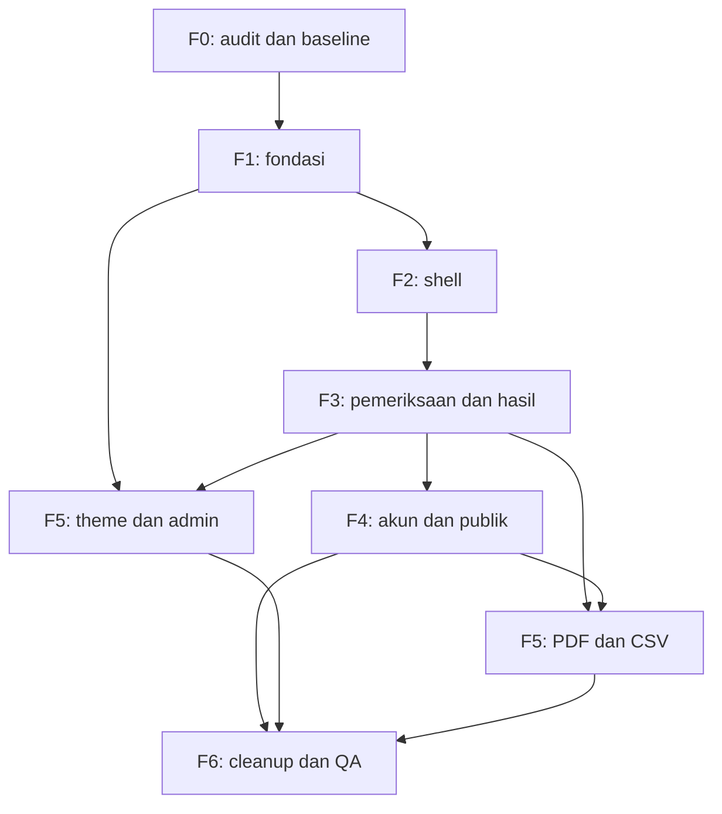

# Hoaxlin — UI/UX Refactor Implementation Plan

| Metadata | Nilai |
| --- | --- |
| Versi | 1.0 |
| Tanggal | 11 Oktober 2026 |
| Status | Audit IP-001 selesai; 1 dari 39 task done, IP-002–IP-039 pending |
| Repository | [jikrilar/hoaxlin](https://github.com/jikrilar/hoaxlin) |
| Baseline kode | `main` — `af173ecb25aca930720db52b3d76201b4b27aaff` |
| Arah desain | Warm Editorial Intelligence; light-only |
| Cakupan | Refactor frontend existing, tanpa migrasi framework atau pipeline |
| Jumlah task | 39, dikelompokkan dalam F0–F6 |

Dokumen terkait: [AGENTS.md](../../AGENTS.md), [OVERVIEW.md](OVERVIEW.md), [DESIGN-SYSTEM.md](DESIGN-SYSTEM.md), [PAGE-SPECIFICATIONS.md](PAGE-SPECIFICATIONS.md), [FRONTEND-ARCHITECTURE.md](FRONTEND-ARCHITECTURE.md).

## 1. Cara menggunakan rencana

Rencana ini mengubah spesifikasi desain, halaman, dan arsitektur menjadi tugas yang dapat dikerjakan, ditinjau, dan diverifikasi. Ia bukan daftar fitur baru maupun bukti bahwa refactor sudah diterapkan.

Pembacaan source untuk penyusunan dokumentasi sudah dilakukan. Audit working copy IP-001 kini selesai dan tercatat pada [AUDIT-IP-001.md](AUDIT-IP-001.md) serta [jurnal TASKS.md](TASKS.md#ip-001--catatan-eksekusi). Baseline browser, perubahan kode aplikasi, build, test, dan QA runtime belum dijalankan; IP-002–IP-039 tetap pending.

Kerjakan dependency sebelum task turunannya. Tuntaskan satu alur dengan error, empty, akses, mobile, dan keyboard sebelum memperluas perubahan. Untuk layout/CSS bersama, cek pula halaman yang masih memakai presentasi lama.

Halaman menggunakan ID P00–P16, A00–A08, E01 dari page specifications; acceptance menggunakan AC dengan ID yang sama. Keputusan FA-01–FA-10 berasal dari frontend architecture. F0–F6 mempertahankan penamaan fase arsitektur; tabel berikut memetakan fase tersebut ke overview.

### 1.1 Status kerja

| Status | Arti | Bukti yang diperlukan |
| --- | --- | --- |
| pending | Belum dikerjakan | Scope dan dependency diketahui |
| in_progress | Implementasi aktif | Task/branch dan file yang sedang diubah jelas |
| blocked | Tidak dapat melanjutkan bagian terkait | Blocker konkret, dampak, dan pekerjaan lain yang masih bisa dilakukan |
| review | Implementasi siap ditinjau | Diff dan hasil validasi tersedia |
| done | Acceptance dan bukti validasi memadai | Tidak ada blocker relevan yang ditutupi |

Dependency adalah urutan kerja, bukan otomatis blocker teknis. IP-002 menutup inventaris kesiapan dan hasil baseline yang dapat dijalankan; mencatat service yang unavailable tidak berarti service itu sudah lulus QA. Task yang membutuhkan runtime tersebut tetap memiliki pemeriksaan yang blocked, sementara pekerjaan independen dapat dilanjutkan. Test skip atau fixture pass tidak berarti inference/pipeline nyata telah diverifikasi. Jika tidak ada perubahan yang diperlukan pada suatu task review, task tetap dapat ditutup dengan alasan dan bukti pemeriksaan.

Tidak ada estimasi hari atau deadline yang dikarang. Urutan ditentukan oleh dependency dan risiko; jadwal dapat dibuat setelah baseline environment dan kapasitas pengerjaan diketahui.

## 2. Baseline dan asumsi pelaksanaan

| Area | Baseline | Pengaruh terhadap rencana |
| --- | --- | --- |
| Publik | Laravel 12, Blade, Tailwind 4, Vite 6 | Form SSR dan route existing dipertahankan |
| JS | Vanilla ES modules; banyak handler inline | Ekstrak module dengan lifecycle/cleanup, tanpa framework baru |
| Progress | Livewire `~4.3.0` + GET status fallback | Uji pemilik tunggal, bootstrap failure, pause/resume, terminal stop |
| Admin | Filament `~5.0`, `/admin` | Native panel/resources; theme terpisah |
| Komponen/token baru | Belum tersedia pada snapshot | Buat sesuai kebutuhan dan struktur target arsitektur |
| Ekspor | DomPDF mandiri dan CSV Laravel | PDF diperiksa aktual; CSV menjaga kontrak data |
| Test | PHPUnit; fixture/fake existing; SQLite test | Gunakan perlindungan existing sebelum menambah test |
| NPM scripts | `dev`, `build` | Tidak menganggap lint/test JS/browser tooling tersedia |
| Docker | Source bundled, image normal no-dev | Rebuild untuk perubahan source; test di host dev/target test |
| AI runtime | BERT artifact/service, RAG, integrasi provider | QA UI dapat memakai test double; keterbatasan E2E dilaporkan |

Manifest menunjukkan constraint dependency; lockfile adalah acuan versi terpasang. Branch main masih sesuai baseline ketika rencana disusun. Periksa kembali checkout saat implementasi dimulai.

Path dalam task relatif terhadap root repo. Path baru/opsional mengikuti frontend architecture dan tidak berarti file sudah ada. Penyingkatan seperti `app.css` di kolom source merujuk lokasi yang lengkap di dokumen arsitektur.

## 3. Scope dan invariant

### 3.1 Hasil dalam scope

- Fondasi token/font/komponen; shell publik dan auth.
- Beranda dan seluruh input yang sudah didukung.
- Progress, hasil final, explanation/evidence/provenance, feedback, dan akses hasil.
- Auth/verifikasi/reset, profil, riwayat/filter/pagination.
- Cara kerja, Tentang, Privasi, Statistik, dan error/fallback.
- Theme/login/dashboard/resources/monitoring Filament.
- PDF, tindakan CSV, cleanup, regression dan QA.

### 3.2 Kontrak yang dijaga

| Contract | Aturan implementasi |
| --- | --- |
| Input/access | Guest teks; login seluruh input sesuai request; verified untuk route yang memang mensyaratkan |
| Domain input | `text`, `image`, `video`, `video_url`, `url`; fields existing |
| Keamanan form | CSRF, CAPTCHA/honeypot, quota/throttle, MIME/size/duration/pixel/URL guards tetap server |
| Submission access | Ownership/admin atau capability guest sesuai service; tidak membuka public share |
| Label | `valid`, `hoax`, `meragukan` tetap domain yang sama |
| Final result | Hanya submission completed dengan result yang sah; classifier parsial bukan final |
| Confidence | Skor classifier, bukan peluang kebenaran atau similarity RAG |
| Pipeline | Model frozen, threshold, retrieval, prompts/provider/queue tidak diubah |
| Evidence | Data nyata, rank/provenance/escaping/link safety dipertahankan |
| Admin | Registered pages, resource permissions, policy dan model constraints tetap |
| Ekspor | PDF sesuai akses/final; CSV scope/format/sanitization existing |

Presentasi meragukan memakai **“Informasi belum terverifikasi oleh sumber terpercaya”** dan **“Ini bukan bukti bahwa informasi benar atau palsu.”** Valid memakai tone neutral, hoax danger, meragukan warning. Jangan menyamakan semantic operation success dengan fakta berita benar.

Tidak termasuk: framework/database migration, retraining, social-video downloader, billing/model chooser, provider settings, public share, completion notification, deployment/tunnel/domain/SMTP, atau perubahan retention. Task produk baru dibuat terpisah bila kontrak tersebut ingin diubah.

## 4. Peta fase dan milestone

| Fase arsitektur | Task | Padanan overview | Milestone |
| --- | --- | --- | --- |
| F0 — Audit | IP-001–IP-003 | Tahap 0 | Working copy, environment dan coverage diketahui |
| F1 — Foundation | IP-004–IP-007 | Bagian tahap 1 | Token/komponen/lifecycle siap dipakai |
| F2 — Shell | IP-008–IP-010 | Bagian tahap 1 | Publik/auth punya shell yang stabil |
| F3 — Alur inti | IP-011–IP-016 | Tahap 2; feedback sebagai bagian hasil | Pemeriksaan dan hasil lengkap |
| F4 — Akun/riwayat/informasi | IP-017–IP-026 | Tahap 3 dan bagian tahap 4 | Semua halaman pendukung publik konsisten |
| F5 — Admin/ekspor | IP-027–IP-034 | Bagian tahap 4 dan tahap 5 | Admin native dan ekspor terverifikasi |
| F6 — Cleanup/QA/handoff | IP-035–IP-039 | Penyelesaian tahap 5 | Refactor siap ditinjau dengan evidence |

Admin theme dapat dimulai setelah fondasi token stabil; hasil/PDF/read-only admin tetap mengikuti dependency semantik hasil. Task tidak harus menunggu seluruh fase sebelumnya jika dependency-nya sudah terpenuhi, tetapi urutan serial di tabel adalah default yang mudah ditinjau.

## 5. Dependency dan urutan prioritas

Dahulukan fondasi dan alur pemeriksaan karena seluruh halaman bergantung padanya. Jangan memoles dashboard/admin widget sebelum kontrak visual dan hasil jelas.

Diagram ini merangkum dependency milestone; dependency task yang lebih tepat ada pada tabel fase.



| Prioritas kerja | Tugas | Alasan |
| --- | --- | --- |
| Fondasi | IP-001–IP-010 | Mencegah perubahan global yang tidak terkendali |
| Alur dan akses hasil | IP-011–IP-016 | Risiko input/security/polling/final semantics tertinggi |
| Akun dan penggunaan berulang | IP-017–IP-022 | Auth, penghapusan, ownership dan akses ekspor |
| Publik dan administrasi | IP-023–IP-032 | Konsistensi copy/populasi data/theme/resource |
| Ekspor dan penutupan | IP-033–IP-039 | Bukti output dan regresi lintas sistem |

Prioritas ini tidak mengubah dependency individual. Seluruh area scope tetap wajib ditinjau; halaman pendukung tidak dibiarkan menggunakan theme lama.

## 6. F0 — Audit dan baseline

**Tujuan:** memastikan rencana dikerjakan pada working copy yang benar dan memiliki kondisi pembanding.

| ID | Tugas dan source utama | Dependensi | Hasil / acceptance minimum | Verifikasi |
| --- | --- | --- | --- | --- |
| IP-001 | **Audit checkout dan instruksi** — Root repo, AGENTS.md, routes/web.php, manifests | — | Branch/SHA, perubahan pengguna, instruksi lokal, route dan scope halaman tercatat; penempatan dokumen refactor ditinjau dan rujukan diselaraskan. | git status/diff; review source dan dokumen |
| IP-002 | **Siapkan baseline verifikasi development/test** — AGENTS.md, Dockerfile, docker-compose.yml, phpunit.xml | IP-001 | Build/Blade/test baseline dijalankan bila environment tersedia; error lama, skip, service/artifact yang hilang dicatat tanpa mengubah data pengguna. | Build, Blade, baseline test, smoke browser |
| IP-003 | **Susun inventaris state dan data QA** — tests/Feature/, tests/Unit/, halaman existing | IP-001, IP-002 | Fixture/fake existing dipetakan untuk role, input, progress, label, evidence, explanation dan error; hanya gap perilaku nyata yang memerlukan fixture/test baru. | Review fixture dan matriks QA |

**Gate F0:** checkout/instruksi/perubahan pengguna tercatat; test/build/browser baseline dan gap environment diketahui; fixture/states QA memiliki rencana yang jelas. Blocker runtime tertentu tidak menghentikan pekerjaan source/CSS yang independen, tetapi membatasi klaim validasinya.

Jika AGENTS existing berbeda dari dokumen refactor yang telah disiapkan, review dan integrasikan instruksi yang relevan; jangan menimpa aturan lokal atau perubahan pengguna tanpa memahami dampaknya. Dokumen refactor dipertahankan di `docs/refactor/`; AGENTS root working copy sudah memuat arah dan kontrak refactor sehingga tidak perlu ditimpa. IP-001 selesai belum menutup gate F0, yang juga memerlukan IP-002 dan IP-003.

## 7. F1 — Fondasi token, komponen, dan lifecycle

**Tujuan:** membangun fondasi reusable tanpa menumpuk stylesheet baru di atas sistem lama.

| ID | Tugas dan source utama | Dependensi | Hasil / acceptance minimum | Verifikasi |
| --- | --- | --- | --- | --- |
| IP-004 | **Implementasikan tokens, bridge Tailwind, dan font** — resources/css/design-tokens.css, app.css; font/head terkait | IP-001, IP-002 | Primitive/semantic tokens sesuai design system; Inter/Newsreader benar-benar dimuat; mapping @theme inline dan fallback tersedia. | Build, computed font, contrast review |
| IP-005 | **Rapikan base CSS dan transisi legacy** — resources/css/app.css, base.css, theme.css bila diperlukan | IP-004 | Light-only, focus, typography dan responsive base bekerja; alias sementara memiliki daftar pemakai; halaman yang belum dimigrasi tetap diperiksa. | Build; smoke semua view publik |
| IP-006 | **Buat komponen dasar reusable** — resources/views/components/ui/, forms/; components.css | IP-004, IP-005 | Button/link, field, alert, empty state dan disclosure punya props kecil, id unik, escaping dan markup semantik; tanpa query di komponen. | Blade compile; form/keyboard/state review |
| IP-007 | **Bangun lifecycle dan helper JS** — resources/js/app.js, core/lifecycle.js, components/ | IP-002, IP-006 | Mount/cleanup idempotent; listener, async import dan restore state aman; tidak menambah framework/global handler baru. | Load normal, navigate, back/forward, console |

**Gate F1:** tokens/font/component state sesuai design system; build berhasil; pemakai legacy tercatat; tidak ada query di komponen atau framework JS baru. Bila base CSS berubah, review seluruh view yang terdampak sebelum melanjutkan.

Scope komponen mengikuti pemakai nyata. Presenter hasil, page CSS terpisah, dan font bundling adalah pilihan implementasi yang harus punya alasan; jangan membuat seluruh file target hanya untuk memenuhi tabel struktur.

## 8. F2 — Shell publik dan auth

**Tujuan:** menyatukan navigasi, runtime, flash, dan struktur form.

| ID | Tugas dan source utama | Dependensi | Hasil / acceptance minimum | Verifikasi |
| --- | --- | --- | --- | --- |
| IP-008 | **Ekstrak fondasi head/runtime dan shell publik** — layouts/app.blade.php, partials/head.blade.php, runtime.blade.php | IP-005, IP-006, IP-007 | Satu main; skip link; Vite/Livewire dimuat sekali; title/description dan stacks existing tetap bekerja. | Blade/build; source DOM; lintas view |
| IP-009 | **Migrasikan navigasi, footer, dan flash** — partials/navigation.blade.php, footer.blade.php; navigation.js | IP-008 | Route dan auth state benar; logout POST; disclosure/menu mobile memakai keyboard; error penting tidak auto-dismiss; tidak ada link palsu. | Guest/user/admin navigation; keyboard/mobile |
| IP-010 | **Buat shell auth dan pola form enhancement** — layouts/auth.blade.php; password-toggle.js, form-submit.js | IP-006, IP-007, IP-008 | Auth ringkas berbagi head/runtime; loading/toggle aksesibel; password tidak dipulihkan; form native tidak bergantung JS. | Blade; native submit, autocomplete, no-JS |

**Gate F2:** AC-P00 serta fondasi shell auth terverifikasi pada desktop/mobile, keyboard, guest/user, dan load/navigation. Satu main, Vite/Livewire sekali, route benar, logout POST, serta error persisten menjadi syarat utama.

Auth memakai shell ringkas. Filament dan PDF tetap memakai renderer/layout masing-masing. JS tidak menyembunyikan semua navigasi/form dasar sebelum enhancement berhasil.

## 9. F3 — Pemeriksaan, progress, hasil, dan feedback

**Tujuan:** menghasilkan satu alur pemeriksaan lengkap yang dapat digunakan dengan semua state utama.

| ID | Tugas dan source utama | Dependensi | Hasil / acceptance minimum | Verifikasi |
| --- | --- | --- | --- | --- |
| IP-011 | **Migrasikan hierarchy beranda dan form teks** — welcome.blade.php, partials/submission/, submission-form.js | IP-003, IP-006, IP-009 | Form menjadi fokus awal; guest teks 50–50.000 karakter; CSRF/CAPTCHA/honeypot, old input dan error recovery terjaga. | SubmissionTest, AtomicCaptchaQuotaTest; browser |
| IP-012 | **Migrasikan URL, gambar, video, dan URL media** — welcome.blade.php; HomeController bila data presentasi perlu diperjelas | IP-011, IP-007 | Seluruh input login mengikuti request/service; empat kategori presentasi mempertahankan lima domain; multipart/limit/required state dan no-JS path benar. | VideoMediaContractTest, ExternalUrlSecurityTest, SubmissionTest |
| IP-013 | **Migrasikan view progress Livewire** — livewire/submission-progress.blade.php; SubmissionProgress.php bila perlu | IP-003, IP-006, IP-008 | Status/stage/persen backend, terminal stop, final guard, failure semantics dan authorization refresh tetap benar; tanpa countdown. | SubmissionProgressTest, FinalResultStateTest, PublicPipelineErrorTest |
| IP-014 | **Perbaiki kepemilikan fallback dan terminal transition** — resources/js/progress/fallback.js, pages/result.js, hasil.blade.php | IP-007, IP-013 | Satu pemilik; satu in-flight request; init runtime bukan hanya wire:id; pause/resume, cleanup, access error dan reload per submission benar. | Network/lifecycle QA; progress/access tests |
| IP-015 | **Migrasikan hasil final, evidence, dan provenance** — hasil.blade.php, components/results/, partials/result/; presenter opsional | IP-006, IP-013, IP-014 | Label/copy/tone, confidence classifier, explanation states, evidence rank/link/escaping dan input disclosure sesuai spesifikasi; hasil parsial tidak final. | ResultEvidencePresentationTest, FinalResultStateTest, GroundedExplanationTest, ExplanationDegradationTest |
| IP-016 | **Migrasikan actions dan feedback hasil** — hasil.blade.php, partials/result/; form helper | IP-015, IP-010 | PDF/riwayat/CSV hanya sesuai akses; feedback verified milik akun dan satu submission; guest tidak diberi form yang pasti ditolak. | FeedbackTest, GuestSubmissionAccessTest, ResultEndpointAuthorizationTest |

**Gate F3:** AC-P01/AC-P02 terpenuhi; bagian hasil bersama untuk P04 tersedia; guest/login input, CAPTCHA/validasi, progress nonterminal/terminal, akses, final-unavailable, label, explanation/evidence, provenance dan feedback diverifikasi.

### 9.1 Pemeriksaan khusus risiko tinggi

- Limit/format/durasi berasal dari request/service/config. G01 hanya ditutup dengan data presentasi yang jelas bila diperlukan.
- Saat submit, tampilkan status mengirim; hapus timer yang berpura-pura menandai extraction/classification sebelum backend mengonfirmasi.
- Livewire aktif menjadi pemilik progress; fallback tidak ikut polling. Marker `wire:id` bukan satu-satunya bukti hydration.
- Fallback tidak membuat request tumpang tindih, berhenti/resume dengan benar, dan menghentikan request ketika akses/session tidak sah.
- Final transition/reload memiliki guard per submission/root, bukan satu flag global untuk seluruh navigasi.
- Hasil completed tanpa result, failed, serta explanation unavailable memiliki pesan nyata.
- Confidence bukan progressbar statis atau peluang kebenaran; evidence kosong bukan sumber pengganti.
- Feedback hanya untuk verified owner account; login saja tidak mengubah guest submission menjadi milik akun.

Perubahan helper/view data yang diperlukan disebutkan dalam task; jangan menyisipkan perubahan inference, threshold, jobs, atau retrieval.

## 10. F4 — Akun, riwayat, informasi, statistik, dan error

**Tujuan:** menutup alur akun/penggunaan berulang serta halaman pendukung publik.

| ID | Tugas dan source utama | Dependensi | Hasil / acceptance minimum | Verifikasi |
| --- | --- | --- | --- | --- |
| IP-017 | **Migrasikan login dan registrasi** — auth/login.blade.php, register.blade.php | IP-010, IP-003 | Credential error/throttle/intended redirect; terms/password confirmation/unique email dan redirect verifikasi dipertahankan. | AuthenticationTest; keyboard/mobile/error submit |
| IP-018 | **Migrasikan lupa/reset password** — auth/forgot-password.blade.php, reset-password.blade.php | IP-010, IP-017 | Status broker, token hidden, policy/confirmation dan expired recovery benar; success redirect login; tidak menjanjikan email tiba. | AuthenticationTest, MailConfigurationTest; broker scenarios |
| IP-019 | **Migrasikan verifikasi email** — auth/verify-email.blade.php; helper/shared alert | IP-010, IP-017 | Resend POST/throttle, signed verify link, verified redirect, profil/ubah email dan logout tetap benar. | AuthenticationTest, MailConfigurationTest; verified/unverified |
| IP-020 | **Migrasikan profil dan konfirmasi hapus akun** — profile.blade.php; dialog/form/password modules | IP-010, IP-019, IP-007 | Tiga form PATCH/PUT/DELETE terpisah; error konteks benar; perubahan email meminta verifikasi; hapus memakai password/focus recovery. | ProfileTest; keyboard, validation, deletion di test data |
| IP-021 | **Migrasikan riwayat, filter, dan pagination** — riwayat.blade.php; shared table/empty state | IP-009, IP-015, IP-006 | Scope pengguna, 15-row pagination, GET filter/sort existing, empty state, reset page dan summary seluruh riwayat jelas; tidak menambah filter video_url. | SubmissionHistoryTest; filter/pagination/mobile |
| IP-022 | **Verifikasi detail riwayat memakai hasil bersama** — hasil.blade.php; RiwayatController::show contract | IP-021, IP-016 | Back context benar; view hasil tidak diduplikasi; forUser tetap boundary; PDF/status/media mempertahankan akses masing-masing. | SubmissionHistoryTest, ResultEndpointAuthorizationTest |
| IP-023 | **Migrasikan Cara kerja dan Tentang** — cara-kerja.blade.php, tentang.blade.php | IP-009, IP-015 | Reading hierarchy editorial; penjelasan input/pipeline/label/score realistis; tidak ada klaim crawler seluruh web atau fitur rencana seolah aktif. | DocumentationWorkflowContractTest, ModelStatisticsClaimsTest; copy review |
| IP-024 | **Rapikan halaman privasi berdasarkan praktik aktual** — kebijakan-privasi.blade.php; config/service dibaca sebagai evidence | IP-009, IP-001 | Struktur terbaca; integrasi/retensi/akses/penghapusan sesuai implementasi; tanggal kebijakan tidak diubah otomatis; tidak mengarang jaminan. | Source-to-copy review; mobile/long text |
| IP-025 | **Migrasikan statistik dan alternatif tabel** — statistik.blade.php, pages/statistics.js bila diperlukan | IP-007, IP-009, IP-006 | Periode/timezone/populasi jelas; byTopic disebut distribusi label; query tidak diubah diam-diam; chart gagal tetap memiliki data tabel. | MonthlyStatisticsBoundaryTest, ModelStatisticsClaimsTest; chart failure QA |
| IP-026 | **Buat error/fallback HTML sesuai scope** — resources/views/errors/; layout minimal/shared components | IP-008, IP-006, IP-014 | 403/404/419/429/500/503 aman dan punya recovery nyata; validation tetap pada form; JSON/status code tidak diubah. | ResultEndpointAuthorizationTest, PublicPipelineErrorTest; HTML/JSON |

**Gate F4:** AC-P03–AC-P14 dan AC-E01 terpenuhi sesuai halaman; auth/reset/verify/profile/history menggunakan kontrak existing; copy publik tidak melebih-lebihkan data/kemampuan; data chart tetap dapat dibaca tanpa chart.

### 10.1 Batas yang tidak ditutup lewat desain

`video_url` belum menjadi filter history/admin yang diterima. Jangan membuat opsi itu aktif atau menganggap “Video” otomatis mencakup kedua domain. CSV mengunduh seluruh riwayat, bukan filter aktif. Summary history juga memiliki scope seluruh riwayat.

Statistik `byTopic` adalah distribusi label; query agregat tidak secara eksplisit completed-only. Perbaiki penjelasan UI, bukan mengubah query agar cocok dengan judul yang diinginkan.

Jika Chart.js dipertahankan, IP-025 menentukan versi dan strategi loading secara eksplisit. Paket tersebut belum dependency NPM pada baseline; jangan menambahkan import yang belum terpasang atau loading global untuk semua halaman.

## 11. F5 — Filament dan ekspor

**Tujuan:** menyelaraskan administrasi dengan brand serta memastikan output unduhan tetap benar.

| ID | Tugas dan source utama | Dependensi | Hasil / acceptance minimum | Verifikasi |
| --- | --- | --- | --- | --- |
| IP-027 | **Buat theme Filament dan login admin light-only** — AdminPanelProvider.php, css/filament/admin/theme.css, vite.config.js | IP-004, IP-005, IP-006 | Theme terdaftar/dibuild; font/primary/light-only benar; CSS publik tidak bocor; middleware/discovery/canAccessPanel terjaga. | Build; A00 keyboard/mobile; admin/non-admin access |
| IP-028 | **Rapikan dashboard dan widgets existing** — app/Filament/Widgets/, provider; custom view bila benar-benar perlu | IP-027, IP-003 | Operational summary/model metadata bersumber nyata; scope/periode dan unavailable jelas; tidak ada KPI/counter buatan. | Widget/source review; A01 data/error/chart states |
| IP-029 | **Migrasikan resource Users** — app/Filament/Resources/Users/ | IP-027, IP-003 | List/create/view/edit native dan existing actions; role/verified/password/model constraints terjaga; bulk delete jelas. | Schema/action/authorization review; form/list/modal QA |
| IP-030 | **Migrasikan resource Datasets** — app/Filament/Resources/Datasets/ | IP-027, IP-003 | Text/label/source/verifier validation; hanya admin verifier; copy kurasi production bukan retraining; actions/policy existing. | DatasetCurationBoundaryTest; form/list/detail QA |
| IP-031 | **Migrasikan resources baca/detail** — Resources/Submissions/, DetectionResults/, Feedback/ | IP-027, IP-015, IP-016 | List/view tetap read-only; status parsial dibedakan; confidence/feedback bukan truth; tidak mengaktifkan Create/Edit legacy. | Resource getPages/actions review; list/detail/access QA |
| IP-032 | **Migrasikan monitoring events dan admin logs** — Resources/SubmissionProcessingEvents/, AdminLogs/ | IP-027, IP-003 | Filter/unit/datetime/long metadata terbaca; tidak menambah edit/clear/retry atau memunculkan secret. | Native table/detail/filter review; admin access |
| IP-033 | **Migrasikan dan render PDF hasil** — hasil-pdf.blade.php; presenter/data view bila diperlukan | IP-015, IP-016, IP-004 | A4, font/line/page break/URL panjang diuji; label/confidence/disclaimer sesuai web; excerpt jelas; tanpa path internal atau evidence palsu. | Render PDF aktual + ResultEndpointAuthorizationTest/FinalResultStateTest |
| IP-034 | **Verifikasi tindakan dan kontrak ekspor CSV** — riwayat.blade.php, hasil.blade.php; SubmissionCsvExporter dibaca/diuji | IP-021, IP-016 | Copy seluruh riwayat; scope/header/skala/BOM/CRLF/placeholder/excerpt/sanitization tidak berubah; tanpa filtered-export baru. | CsvExportTest, TranslationProvenanceExportTest, CsvCellSanitizerTest |

**Gate F5:** AC-A00–AC-A08, AC-P15, dan AC-P16 memiliki bukti. Light-only berlaku pada panel, auth/admin access tetap, resource mutasi mengikuti baseline, PDF aktual diperiksa, CSV contract pass.

Theme mengikuti generator Filament versi terpasang. Review perubahan Vite/provider/package/lockfile yang dihasilkan; public reset/shell tidak dimuat oleh theme admin. Jangan mengedit vendor atau published assets.

Users/Datasets memiliki list/create/view/edit dan actions existing. Submissions/Detection results/Feedback tetap list/view read-only. Processing events/Admin logs tetap monitoring; tidak ditambah clear/edit/retry baru.

PDF mengonsumsi data controller yang tersedia. Evidence tambahan bukan bagian otomatis refactor; jika diperlukan, definisikan data contract dan task terpisah. Fonts, Bahasa Indonesia, URL panjang, excerpt dan page breaks diuji pada file PDF, bukan hanya HTML view.

## 12. F6 — Cleanup, regression, dan handoff

**Tujuan:** menutup pemakai legacy serta menyediakan evidence yang cukup untuk reviewer.

| ID | Tugas dan source utama | Dependensi | Hasil / acceptance minimum | Verifikasi |
| --- | --- | --- | --- | --- |
| IP-035 | **Cleanup setelah seluruh pemakai dimigrasi** — CSS/JS/views target, font imports, legacy globals/aliases | Seluruh migrasi IP-011–IP-034 | Tidak ada alias/orphan handler/interval/gradient/reveal/counter tersisa tanpa alasan; source scanner dan dependency cleanup berdasarkan pemakai nyata. | rg pemakai; build; smoke area terdampak |
| IP-036 | **Validasi build, Blade, PHP dan regression final** — Files changed; tests existing; lockfiles/build manifest | IP-035 | Build/Blade dan suite relevan/penuh sesuai perubahan selesai; failure lama dibedakan; skip/blocker dicatat; test keamanan tidak dilemahkan. | npm build; view cache/clear; test; Pint bila PHP berubah |
| IP-037 | **Lengkapi QA browser lintas halaman/state** — Halaman implementasi; matriks QA dan hasil review | IP-036 | Coverage role/state/mobile/keyboard/no-JS/lifecycle/long text dan admin tercatat; tidak hanya screenshot ideal; regresi dipulihkan dan cek terdampak diulang. | Matriks QA browser; console/network |
| IP-038 | **Tutup gap, sinkronkan keputusan dan bukti** — Dokumen refactor; evidence task/PDF/CSV/admin | IP-036, IP-037, IP-033, IP-034 | G01–G08 punya keputusan/status; perubahan final diselaraskan; bukti export/admin yang sudah valid digabung, bukan test diulang tanpa alasan. | Traceability, known gaps, decision/evidence review |
| IP-039 | **Siapkan handoff yang dapat ditinjau** — Final diff, review notes, status task dan known limitations | IP-038 | Scope/hasil/risk/validasi/reproduksi lengkap; semua AC dibuktikan atau blocker dinyatakan; deployment bukan bagian penyusunan dokumen ini. | Final review dan definition of done |

**Gate F6:** seluruh task scope berada done atau memiliki blocker konkret yang membuat pekerjaan dinyatakan belum selesai; acceptance memiliki evidence; tidak ada klaim “refactor selesai” dengan AC penting yang belum diperiksa.

Jalankan pemeriksaan kembali setelah perubahan cleanup/integrasi yang memengaruhi hasil. Jika build/test suatu area sudah pass dan tidak ada perubahan/failure/risiko baru, gunakan evidence yang ada; tidak perlu mengulang hanya untuk memenuhi ritual checklist.

## 13. Traceability halaman ke task

| Halaman / acceptance | Task utama | Bukti minimum |
| --- | --- | --- |
| P00 / AC-P00 | IP-008, IP-009 | Main/runtime/nav/flash; keyboard/mobile/role |
| P01 / AC-P01 | IP-011, IP-012 | Semua input, CAPTCHA, validation recovery, native submit |
| P02 / AC-P02 | IP-013–IP-016 | Progress/owner/final/labels/evidence/feedback/access |
| P03 / AC-P03 | IP-021 | Scope/filter/sort/15-row pagination/empty/mobile |
| P04 / AC-P04 | IP-022, IP-013–IP-016 | Shared result, forUser, back context, endpoint access |
| P05 / AC-P05 | IP-017 | Login/throttle/intended/remember/password safety |
| P06 / AC-P06 | IP-017 | Terms/confirmation/unique email/verification redirect |
| P07 / AC-P07 | IP-018 | Broker status/error/email recovery/throttle |
| P08 / AC-P08 | IP-018 | Token/expired recovery/password policy/success redirect |
| P09 / AC-P09 | IP-019 | Signed/auth verify, resend throttle, verified redirect |
| P10 / AC-P10 | IP-020 | PATCH/PUT/DELETE, email reverify, dialog/password/session |
| P11 / AC-P11 | IP-023 | Input/pipeline/label limitations akurat |
| P12 / AC-P12 | IP-023 | Copy/identitas/link nyata/readability |
| P13 / AC-P13 | IP-024 | Praktik data/retensi/penghapusan dan long text |
| P14 / AC-P14 | IP-025 | Month boundary/population/table/chart fallback |
| P15 / AC-P15 | IP-033 | PDF aktual, access/final, font/page break/provenance |
| P16 / AC-P16 | IP-034, IP-021 | Scope full history, header/scale/CSV sanitization |
| A00 / AC-A00 | IP-027 | Native login/light-only/canAccessPanel |
| A01 / AC-A01 | IP-028 | Widget scope/periode/model/unavailable |
| A02 / AC-A02 | IP-029 | Native CRUD/actions, constraints, password safety |
| A03 / AC-A03 | IP-030 | Verifier/kurasi/label/source/policy |
| A04 / AC-A04 | IP-031 | View-only submission, preview/status/final distinction |
| A05 / AC-A05 | IP-031 | View-only result, classifier confidence/version |
| A06 / AC-A06 | IP-031 | View-only feedback, escaped comment, boolean meaning |
| A07 / AC-A07 | IP-032 | Monitoring stage/outcome/duration/access |
| A08 / AC-A08 | IP-032 | Monitoring action/target/time/access |
| E01 / AC-E01 | IP-026 | Safe message, status/JSON/recovery |
| Lintas halaman | IP-004–IP-010, IP-035–IP-039 | Design tokens, lifecycle, keyboard/reflow, final evidence |

Traceability adalah coverage plan, bukan hasil test. Satu task dapat menutup beberapa AC, tetapi tetap memerlukan evidence untuk state tiap halaman yang berbeda.

### 13.1 Traceability keputusan arsitektur

| Keputusan | Task utama | Bukti |
| --- | --- | --- |
| FA-01 — SSR Blade | IP-011, IP-012, IP-017–IP-020 | Form native dan server contract tetap |
| FA-02 — Komponen reusable | IP-006, IP-015 | Props/slots kecil; tidak ada query dalam komponen |
| FA-03 — Token/entry terpisah | IP-004, IP-005, IP-027 | Public/admin build dan scope CSS |
| FA-04 — Vanilla modules | IP-007 | Lifecycle/cleanup; tanpa framework baru |
| FA-05 — Satu pemilik progress | IP-013, IP-014 | Init/handoff/pause/terminal/request lambat |
| FA-06 — Filament native | IP-027–IP-032 | Native resource/action/policy tetap |
| FA-07 — Ekspor mandiri | IP-033, IP-034 | PDF aktual dan CSV contract |
| FA-08 — Migrasi bertahap | IP-001–IP-039 | Gate/dependency/pemakai legacy/evidence |
| FA-09 — Data sensitif di server | IP-007, IP-012, IP-017–IP-020, IP-037 | Tidak ada storage/log client sensitif |
| FA-10 — Dependency terarah | IP-004, IP-025, IP-027, IP-035 | Package/lockfile change memiliki kebutuhan nyata |

## 14. Gap baseline dan risiko implementasi

| Gap | Keputusan rencana | Task terkait |
| --- | --- | --- |
| G01 — Limit video view data belum lengkap | Ambil dari config/service; tambahan view data hanya presentasi | IP-012 |
| G02 — Filter video_url belum didukung | Pertahankan filter existing; fitur filter baru terpisah | IP-021, IP-031 |
| G03 — CSV tidak mengikuti filter | Copy seluruh riwayat; format/exporter tetap | IP-021, IP-034 |
| G04 — Statistik label/populasi berbeda dari klaim judul | Perjelas copy/scope; tidak mengubah populasi diam-diam | IP-025 |
| G05 — Evidence PDF belum explicit data contract | Align makna hasil; jangan membuat referensi palsu | IP-033 |
| G06 — Create/Edit legacy tidak aktif pada resource read-only | Ikuti getPages/actions/resource permissions | IP-031, IP-032 |
| G07 — Runtime/provider/artifact dapat unavailable | Fixture QA, unavailable state, laporkan batas E2E | IP-002, IP-003, IP-015, IP-028 |
| G08 — Global legacy CSS/JS dan bundled Docker | Audit pemakai, cleanup bertahap, rebuild source | IP-005, IP-007, IP-035, IP-036 |

| Risiko | Pencegahan | Respons jika ditemukan |
| --- | --- | --- |
| CSS baru merusak halaman lama | Alias transisi terbatas dan smoke lintas view | Perbaiki pemakai; jangan menambah override tanpa sumber jelas |
| Polling/listener/reload ganda | Mount/cleanup/owner/in-flight guard | Reproduksi navigate/hidden tab; perbaiki lifecycle sebelum menutup F3 |
| Copy baru melemahkan makna hasil | Shared mapping dan review semua label | Selaraskan web/PDF/admin; label domain tetap |
| Test exact-string gagal | Review intention dan update assertion terkait | Pertahankan assertion keamanan/provenance; jangan hapus test |
| Admin CSS/assets salah | Theme terpisah dan build/scanner review | Perbaiki entry/provider/import; published assets tidak diedit |
| PDF font/layout berbeda | Render PDF aktual dengan long content | Gunakan CSS/font DomPDF yang didukung |
| QA runtime tidak lengkap | Catat fixture vs real service dan blocker | Lanjutkan pekerjaan independen; jangan klaim E2E |
| Working copy/data pengguna tertimpa | Audit status/diff; test data terisolasi | Hentikan perubahan yang berisiko, pulihkan hanya perubahan sendiri |

Gap di luar scope tidak harus diimplementasikan untuk menyelesaikan UI refactor; keputusan dan keterbatasannya harus jelas. Gap yang merupakan acceptance UI dalam scope tetap harus ditutup atau membuat status terkait belum selesai.

## 15. Matriks QA minimum

Gunakan data test/sanitized. Skenario yang sudah dilindungi test tetap diperiksa visual bila tampilan/interaksi berubah.

| Area | Skenario minimum | Hasil yang diperiksa |
| --- | --- | --- |
| Shell | Guest, login, unverified, verified, admin | Navigation/route/logout/runtime/focus benar |
| Beranda teks | Kosong, batas min/max, valid, validation error | Field/error/old input/CAPTCHA dan submit |
| Media/URL | Setiap domain input; format/size/host tidak valid | Limit, login boundary, multipart, error, preview cleanup |
| No JS | Beranda/auth/hasil | Form dasar dapat ditemukan; status/refresh dan copy jelas |
| Bootstrap gagal | Runtime Livewire tidak aktif | Fallback benar-benar dapat mengambil alih |
| Pending/processing | Stage tersedia/tidak dikenal; proses lama | Persen backend, tidak ada final palsu/countdown |
| Request lambat | Respons melebihi interval normal | Tidak ada request bertumpuk |
| Lifecycle | Navigate antarhasil, back/forward, hidden/visible | Cleanup/resume/guard per submission; tidak ada timer bocor |
| Completed | Final result; completed tanpa result | Final guard dan recovery state |
| Failed/network/access | Sanitized failed; offline; 403/404/419/429 | Error transport tidak berubah jadi domain failed; loop berhenti sesuai konteks |
| Label/score | Valid, hoax, meragukan, null/unavailable | Copy/tone/score asal classifier tepat |
| Explanation/evidence | Ready/pending/unavailable; evidence ada/kosong | Data nyata, rank/escaping/link safety |
| Feedback | Verified owner, guest, bukan owner, duplicate | Form/action sesuai akses; pesan benar |
| Riwayat | Kosong, berisi, filter kosong, validation, sort/page | Scope/pagination/query string/summary dan full CSV |
| Auth/reset/verify | Invalid credential, throttle, broker error, expired token, resend | Recovery dan contract server |
| Profil | Identity/password error, email change, delete error/success | Form context, reverify, focus dan session |
| Admin | Non-admin; list/form/detail/filter/modal; unavailable widgets | Access/native actions/light-only/density/readability |
| Statistik | No data, zero month, long labels, chart gagal | Population/periode/tabel alternative |
| PDF/CSV | Labels, nonfinal/access denied, long text, CSV formula input | File output nyata, scope/data/access/sanitization |
| Responsive | Reflow 320; layout 360/768/1280; zoom 200% | Tidak ada overflow global/truncation penting |
| Keyboard/motion | Tab, Escape, focus return, reduced motion | Interaksi dapat digunakan; content tidak menunggu reveal |
| Error HTML/JSON | Error code dan request Accept berbeda | Status code/payload/recovery sesuai contract |

QA penghapusan/bulk action dilakukan pada data test, bukan data pengguna aktif. Tidak membuat seed demo pada environment pengguna hanya untuk screenshot.

## 16. Perintah validasi dan pencatatan evidence

### 16.1 Pemeriksaan awal

Jalankan dari working copy repo yang benar:

```bash
git status --short
git branch --show-current
git rev-parse HEAD
git diff --stat
```

Baca AGENTS root dan instruksi lebih dekat dengan file yang akan diubah. Jangan menjalankan reset/clean untuk memaksa working tree kosong.

### 16.2 Host development/test

Dependency dan .env yang sesuai harus tersedia. `npm ci` dipakai saat menyiapkan dependency, bukan diulang setelah setiap edit CSS.

```bash
npm ci
npm run build
php artisan view:cache
php artisan view:clear
```

Cache/clear dijalankan pada development/test yang sedang dikerjakan, bukan environment aktif lain. Build memeriksa aset; view cache memeriksa kompilasi Blade. Keduanya tidak membuktikan authorization atau interaksi browser.

Contoh targeted test alur inti:

```bash
php artisan test --filter='SubmissionTest|AtomicCaptchaQuotaTest|VideoMediaContractTest|ExternalUrlSecurityTest'
php artisan test --filter='SubmissionProgressTest|FinalResultStateTest|GuestSubmissionAccessTest|ResultEndpointAuthorizationTest'
```

Pilih filter sesuai file/perilaku yang berubah; kelompok test lain ada pada tabel task. Jalankan suite penuh setelah perubahan lintas layout/alur atau menjelang penutupan refactor:

```bash
php artisan test
```

Jika PHP diubah, gunakan `vendor/bin/pint --test` pada file terkait. Jalankan Python/evaluation tests hanya bila service Python atau evaluation benar-benar berubah. Jangan menambah test yang sekadar menyalin class CSS.

Baseline tidak memiliki `npm run lint`, `npm test`, Playwright, atau Cypress. Tooling baru dapat menjadi task kebutuhan tersendiri; rencana ini tidak mensyaratkan pemasangannya.

### 16.3 Compose existing

Source dibundel ke image. Untuk melihat perubahan pada stack lokal yang sudah dikonfigurasi:

```bash
docker compose build app
docker compose up -d --force-recreate app queue scheduler
docker compose ps
```

Restart saja tidak memperbarui source. Image normal no-dev; PHPUnit/Pint tidak diasumsikan tersedia di app. Host dev atau Docker target test mengikuti AGENTS.md.

`composer run dev` baseline mempunyai path Python Windows dan tidak memulai RAG. Bootstrap Linux melakukan migration, memerlukan BERT, dan belum memulai RAG pada snapshot; bukan langkah untuk setiap pengecekan UI. Kebutuhan service/artifact dicatat pada IP-002.

Tidak ada migration schema yang direncanakan dalam UI refactor. Jangan memakai `migrate:fresh`, `db:wipe`, `docker compose down -v`, atau reset data sebagai pemulihan build.

### 16.4 Evidence per task

Catat ringkas pada task/PR/review notes; tidak wajib membuat laporan terpisah untuk setiap perubahan kecil.

| Field | Isi |
| --- | --- |
| Task/status | IP-ID; pending/in_progress/blocked/review/done |
| Checkout | Branch dan commit aktual |
| Scope | Page IDs, FA decisions dan AC yang terkait |
| Perubahan | File dan perilaku akhir |
| Validasi | Perintah, exit/result, browser/state/output yang diperiksa |
| Batas | Skip, fixture vs real service, blocker yang belum ditutup |
| Evidence | Ringkasan/screenshot QA internal atau PDF test sesuai kebutuhan |
| Berikutnya | Task dependency yang siap atau masalah konkret yang harus diperbaiki |

Screenshot browser dipakai untuk QA internal bila membantu; tidak memasukkan data pribadi ke deliverable. Jangan mengklaim test/build/browser pass jika belum dijalankan.

## 17. Paket kerja dan review

Paket berikut adalah rancangan pembagian diff, bukan PR yang sudah dibuat atau instruksi untuk publish otomatis. Pecah lagi bila scope sulit ditinjau, terutama admin resource.

| Paket | Task | Fokus review |
| --- | --- | --- |
| R0 — Baseline | IP-001–IP-003 | Instruksi, environment, contract/state coverage |
| R1 — Foundation | IP-004–IP-007 | Token/font/base/komponen/lifecycle |
| R2 — Shell | IP-008–IP-010 | Public/auth runtime, navigation/flash/native forms |
| R3 — Input | IP-011–IP-012 | Semua input/security/recovery/no-JS |
| R4 — Progress | IP-013–IP-014 | Owner, authorization, cleanup, terminal/network |
| R5 — Result | IP-015–IP-016 | Final semantics, evidence, provenance, feedback/access |
| R6 — Account | IP-017–IP-020 | Auth/broker/verify/profile/delete |
| R7 — History | IP-021–IP-022 | Ownership/filter/pagination/shared result |
| R8 — Public support | IP-023–IP-026 | Copy/population/statistics/error contracts |
| R9 — Admin | IP-027–IP-032 | Theme/native resources/actions/policies/monitoring |
| R10 — Export | IP-033–IP-034 | Actual PDF dan CSV contract |
| R11 — Integration | IP-035–IP-039 | Cleanup/regression/coverage/evidence/handoff |

Review description menjelaskan masalah dan perilaku akhir, file/area terdampak, validasi, dan batas yang material. Tidak perlu mengulang sejarah percakapan atau pendekatan yang dibatalkan.

Jika R0 hanya audit, deliverable bisa berupa catatan tanpa code PR. Jika perubahan token/shell bersama memengaruhi paket lain, selesaikan integrasi dan cek pemakainya sebelum menandai dependency done.

## 18. Perubahan scope, rollback, dan kesiapan rilis

### 18.1 Perubahan scope

Perubahan kontrak seperti filtered CSV, filter video_url, query statistik completed-only, evidence PDF baru, notification preference, atau retry submission dicatat sebagai task produk tersendiri dengan kontrak/tesnya. Jangan memasukkannya sebagai cleanup UI.

Perubahan nama helper/module rutin boleh ditentukan saat implementasi; perbarui tabel path arsitektur. Palet/font/light-only dan semantik hasil tetap mengikuti baseline desain kecuali pengguna meminta revisi.

### 18.2 Pemulihan regresi

- Simpan perubahan dalam diff/commit kecil yang dapat ditinjau.
- Identifikasi commit/file milik refactor yang menyebabkan regresi; pertahankan perubahan pengguna lain.
- Perbaiki atau revert perubahan sendiri setelah meninjau dampak; jangan hard-reset seluruh repo.
- Pada Compose bundled source, versi kode yang dipulihkan harus dibuild/recreate juga.
- Karena tidak ada schema/data migration dalam scope, pemulihan UI tidak membutuhkan wipe volume atau rollback data.
- Setelah perbaikan, ulangi pemeriksaan yang terdampak; jangan menjalankan semua test berulang tanpa alasan.

### 18.3 Kesiapan handoff

Handoff memuat final diff, cara menjalankan/meninjau, task/AC coverage, hasil build/test/browser/export, serta known limitations. Deployment, domain/tunnel, SMTP, dan publikasi merupakan pekerjaan operasional terpisah. Penyusunan dokumen ini tidak mengubah repo atau melakukan deployment.

## 19. Definition of done keseluruhan

- [ ] F0 baseline working copy/environment/state tercatat.
- [ ] Seluruh halaman scope menggunakan fondasi light-only ivory–evergreen dan typography yang benar.
- [ ] Komponen/layout/CSS/JS mengikuti batas tanggung jawab arsitektur.
- [ ] Form native, validasi/recovery/CAPTCHA/upload/access tidak regresi.
- [ ] Satu pemilik progress; lifecycle/hidden tab/terminal/error terverifikasi.
- [ ] Final result, abstention, confidence, evidence/explanation/provenance memiliki makna tepat.
- [ ] Auth/verification/profile/history/feedback mengikuti server contract.
- [ ] Copy informasi/privasi/statistik sesuai data dan kemampuan aktual.
- [ ] Admin tetap native Filament dengan access/pages/actions/policy existing.
- [ ] PDF aktual dan CSV scope/data/sanitization diverifikasi.
- [ ] Legacy CSS/JS/alias/globals yang tidak lagi dipakai dibersihkan.
- [ ] Mobile/reflow/keyboard/zoom/reduced motion dan error/empty/unavailable diperiksa.
- [ ] Build/Blade/test yang relevan selesai; failure/skip/blocker dilaporkan.
- [ ] Traceability task → page → AC → evidence lengkap.
- [ ] Keputusan final serta keterbatasan selaras dengan dokumen pendamping.
- [ ] Tidak ada task penting belum diverifikasi yang disembunyikan oleh status “selesai”.

## 20. Titik mulai dan pemeliharaan

Mulai dengan **IP-001**, lalu IP-002 dan IP-003. Setelah fondasi baseline diketahui, lanjutkan F1 dan F2 sebelum mengubah alur inti. Rencana ini sudah cukup untuk memulai audit; tidak membutuhkan tanggal atau estimasi baru sebagai syarat.

Gunakan template instruksi kerja singkat berikut untuk satu task:

```text
Kerjakan IP-<nomor> dari IMPLEMENTATION-PLAN.md.
Baca AGENTS.md dan dokumen terkait; periksa checkout serta perubahan yang ada.
Pastikan dependency task terpenuhi dan catat page/AC terdampak.
Implementasikan scope task dengan menjaga contract backend.
Jalankan validasi yang relevan, lalu laporkan perubahan, hasil, skip/blocker,
dan status task berdasarkan evidence.
```

Template digunakan ketika implementasi memang diminta; penyusunan dokumen ini tidak menjalankan tugas tersebut.

Sumber rencana: dokumen Hoaxlin yang ditautkan di awal dan [source repository pada baseline](https://github.com/jikrilar/hoaxlin/tree/af173ecb25aca930720db52b3d76201b4b27aaff). Rencana ini mencakup implementasi **Hoaxlin UI/UX refactor**.

`IMPLEMENTATION-PLAN.md` berada di `docs/refactor/`; path source dan perintah tetap relatif root repo. Perbarui status dan evidence ketika task benar-benar dikerjakan. Jika task dipecah atau dependency berubah, pertahankan ID lama sebagai referensi atau catat mapping penggantinya; jangan menghilangkan traceability.
