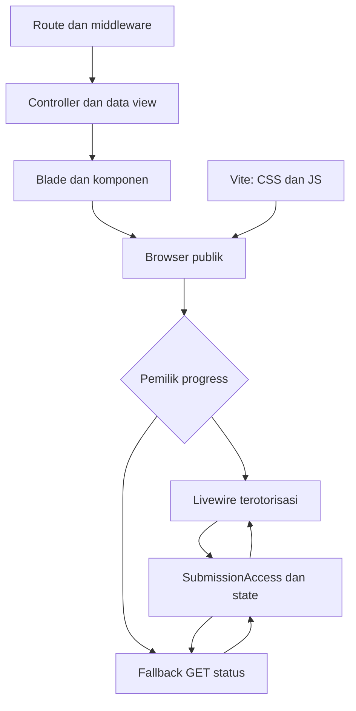
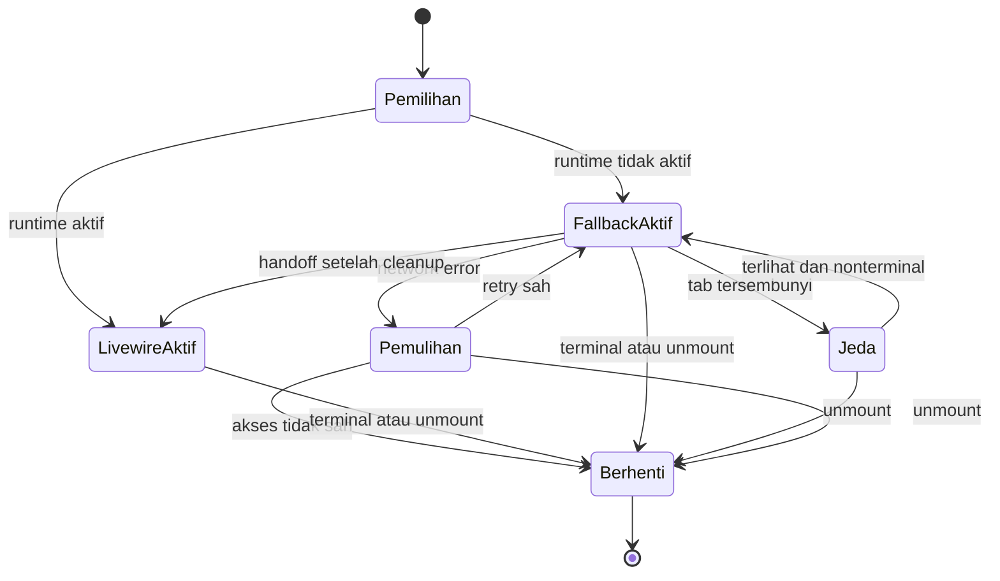

# Hoaxlin — Frontend Architecture

| Metadata | Nilai |
| --- | --- |
| Versi dokumen | 1.0 |
| Tanggal | 11 Oktober 2026 |
| Status | Arsitektur target refactoring; belum diimplementasikan atau diuji pada runtime |
| Repository | [jikrilar/hoaxlin](https://github.com/jikrilar/hoaxlin) |
| Baseline kode | `main` — `af173ecb25aca930720db52b3d76201b4b27aaff` |
| Arah desain | Warm Editorial Intelligence; light-only |
| Dokumen terkait | [AGENTS.md](../../AGENTS.md), [OVERVIEW.md](OVERVIEW.md), [DESIGN-SYSTEM.md](DESIGN-SYSTEM.md), [PAGE-SPECIFICATIONS.md](PAGE-SPECIFICATIONS.md) |

## 1. Tujuan dan lingkup

Dokumen ini menetapkan cara menyusun frontend Hoaxlin agar refactor dapat dilakukan bertahap, konsisten, dan mudah dipelihara. Cakupannya adalah rendering Blade, layout, komponen, token/CSS, JavaScript, progress Livewire, tema Filament, serta batas ekspor PDF/CSV.

`DESIGN-SYSTEM.md` menentukan nilai visual dan makna komponen. `PAGE-SPECIFICATIONS.md` menentukan isi, interaksi, akses, state, dan acceptance tiap halaman. Dokumen ini menentukan tempat implementasi serta hubungan antarbagian. `AGENTS.md` tetap menjadi panduan kerja agent dan perlindungan kontrak backend.

**Baseline** berarti struktur/perilaku yang ada pada commit di atas. **Target** berarti struktur yang diusulkan. File yang diberi status baru atau opsional belum tersedia pada snapshot. Nama folder target bukan bukti bahwa implementasi sudah selesai.

Refactor tidak mengganti framework, membuat SPA, menambah API publik, mengubah pipeline AI, ataupun mengubah database, quota, retention, dan authorization. Perubahan data presentasi yang diperlukan harus disebutkan dan diuji sebagai bagian task terkait.

## 2. Baseline frontend yang diverifikasi

| Lapisan | Kondisi saat ini | Implikasi |
| --- | --- | --- |
| Web | Laravel 12; rendering server melalui Blade | Route/controller/request tetap menjadi kontrak utama |
| CSS | Tailwind CSS `^4.0.0`, plugin `@tailwindcss/vite`; satu `resources/css/app.css` | Gunakan pendekatan CSS-first, bukan konfigurasi Tailwind 3 baru |
| Build | Vite `^6.0.11`; `laravel-vite-plugin ^1.2.0` | Dua entry publik: CSS dan JavaScript |
| JavaScript | ES modules; vanilla JS dan handler inline | Ekstraksi modul tidak membutuhkan framework frontend baru |
| Bootstrap JS | Axios `^1.7.4` diekspos melalui `window.axios` | Audit pemakai sebelum menghapus global/import |
| Progress | Livewire `~4.3.0`, `SubmissionProgress`, fallback GET status | Lifecycle dan kepemilikan polling perlu jelas |
| Admin | Filament `~5.0`, panel `/admin`, primary Blue | Tema admin terpisah belum dibuat |
| Ekspor | Template DomPDF terpisah; exporter CSV Laravel | Bukan turunan langsung DOM halaman web |
| Statistik | Chart.js dimuat dari CDN tanpa versi pada URL view | Bukan dependency NPM yang sudah terkunci |
| Scripts NPM | Hanya `dev` dan `build` | Tidak ada script lint, test JS, atau browser test yang siap dipakai |
| Komponen Blade | `resources/views/components/` belum ada | Ekstraksi reusable dimulai dari kebutuhan nyata |
| Source Docker | Source dan frontend dibundel ke image; tanpa code bind mount | Perubahan membutuhkan rebuild, bukan hanya restart |

Angka dependency di atas adalah constraint manifest, bukan klaim versi patch terbaru. Versi terpasang harus dibaca dari `composer.lock` dan `package-lock.json`; pertahankan lockfile.

### 2.1 Masalah struktur yang terlihat dari source

- `app.css` mencampur token dark theme lama, reset, typography, glass/gradient, komponen, responsive rules, dan animasi.
- `layouts/app.blade.php` mencampur shell, font, inline presentation, navigation JS, dropdown, serta auto-dismiss flash.
- `welcome.blade.php` memuat beberapa form, input switching, preview, validasi ringan, dan timer yang menggambarkan tahapan analisis sebelum respons backend.
- `hasil.blade.php` memuat progress, hasil final, evidence, feedback, inline polling, dan handler presentasi.
- `app.js` mengandung reveal observer, counter animation, dan global `window.Hoaxlin`.
- Fallback polling saat ini menganggap marker `wire:id`/directive atau global Livewire sebagai bukti runtime tersedia. Marker server saja tidak membuktikan hydration berhasil.
- Fallback menghentikan interval saat tab tersembunyi, tanpa pemulihan eksplisit saat terlihat kembali; interval juga tidak menunggu request sebelumnya selesai.
- Template progress memakai guard reload global; state tersebut perlu diperiksa ketika berpindah antar-submission.
- View auth/profil mengulang password toggle, submit loading, dan style. Hasil memiliki landmark tambahan di dalam `main` layout.
- Panel admin belum mengatur light-only atau custom theme; template PDF masih memiliki presentasi lama.

Temuan ini berasal dari pembacaan source. Dampak visual, urutan loading, dan bug runtime perlu direproduksi melalui browser saat implementasi.

## 3. Keputusan arsitektur

| ID | Keputusan | Alasan dan batas |
| --- | --- | --- |
| FA-01 | Pertahankan SSR Blade dan route Laravel | Form, session, validasi, dan authorization sudah terpusat di server |
| FA-02 | Gunakan anonymous Blade components untuk pola reusable | API kecil; class-based component hanya jika logika presentasi memang memerlukannya |
| FA-03 | Bagi primitive/semantic tokens; publik dan admin punya entry CSS sendiri | Konsistensi brand tanpa membocorkan reset/style shell ke Filament |
| FA-04 | Vanilla ES modules untuk enhancement publik | Tidak menambah React, Vue, TypeScript, Inertia, atau state store |
| FA-05 | Livewire memiliki progress bila runtime aktif; fallback memiliki polling hanya bila Livewire tidak aktif | Tidak ada dua pemilik request/timer untuk submission yang sama |
| FA-06 | Filament tetap mengelola admin | Resources, policies, forms, tables, actions, dan notifications native dipertahankan |
| FA-07 | PDF memakai renderer/style sendiri; CSV mempertahankan kontrak data | Makna hasil konsisten, implementasi rendering berbeda |
| FA-08 | Migrasi per alur lengkap dengan cleanup | Menghindari penumpukan override dan halaman yang tertinggal |
| FA-09 | Tidak menyimpan input sensitif atau kredensial di browser storage | Session/backend tetap menjadi sumber akses dan data |
| FA-10 | Dependency baru hanya untuk kebutuhan yang dinyatakan | Tidak memasang library komponen/testing/chart sebagai langkah otomatis |

Pembagian modul di bawah adalah batas tanggung jawab. Jangan membuat seluruh folder/file sekaligus jika belum ada pemakainya.

## 4. Lapisan dan arah dependensi

| Lapisan | Tanggung jawab | Boleh bergantung pada | Tidak menjadi pemilik |
| --- | --- | --- | --- |
| Route, middleware, controller, request | Akses, validasi, data view, respons | Service/model/domain existing | Style dan listener browser |
| Presenter opsional | Mapping nilai ke teks/tone/format presentasi | Nilai domain/config yang sudah diberikan | Query, otorisasi, inference, threshold |
| Page Blade | Komposisi halaman dan kondisi server | Layout, partial, komponen, data view | Polling global dan aturan bisnis baru |
| Komponen Blade | Markup/pola reusable, label/hint/error/state | Props/slots, semantic class | Query Eloquent atau service AI |
| CSS | Token, layout, visual state, responsive rules | Token bersama dan aturan renderer | Penentuan label/access/status domain |
| JS publik | Menu, selector, preview, loading, enhancement | DOM contract dan endpoint existing | Authorization dan kebenaran hasil |
| Livewire progress | Refresh state yang diotorisasi | `SubmissionAccess`, submission, enum stage | Mengganti klasifikasi/pipeline |
| Filament | Shell dan resource admin native | Provider, resources, schemas, tables, policies | Shell/reset publik |
| PDF/CSV | Ekspor sesuai akses/data existing | Controller/exporter yang sah | Runtime JS publik |

Diagram berikut menunjukkan aliran render dan pembaruan status, bukan endpoint baru.



Hanya satu cabang progress aktif pada satu waktu. Keduanya membaca state backend yang sama. Hasil final tetap dirender melalui halaman yang diotorisasi.

## 5. Struktur file target

Pertahankan nama top-level view dan controller agar route/view lookup existing tidak berubah. Ekstrak bagian di dalamnya secara bertahap.

### 5.1 CSS dan JavaScript

| Path | Status | Tanggung jawab |
| --- | --- | --- |
| `resources/css/app.css` | Existing, dirapikan | Entry CSS publik; import Tailwind/token/styles |
| `resources/css/design-tokens.css` | Baru | Primitive dan semantic tokens bersama, tanpa reset/layout |
| `resources/css/theme.css` | Baru bila bridge perlu dipisah | Mapping `@theme inline` untuk utility publik |
| `resources/css/base.css` | Baru | Base publik, focus, typography fungsional, aksesibilitas |
| `resources/css/components.css` | Baru | Pola reusable; pecah lagi hanya jika ukuran/pemakai membenarkan |
| `resources/css/pages/` | Opsional | Style khusus halaman yang tidak cocok sebagai utility/komponen |
| `resources/css/filament/admin/theme.css` | Baru melalui generator | Theme panel admin, token bridge dan override terbatas |
| `resources/js/app.js` | Existing, dirapikan | Entry publik dan registrasi lifecycle |
| `resources/js/bootstrap.js` | Tersedia IP-007; audit IP-035 | Registrasi lifecycle dan lazy page modules lokal, tanpa Axios/global baru |
| `resources/js/core/lifecycle.js` | Baru | Mount, cleanup, guard init, navigasi |
| `resources/js/components/navigation.js` | Baru | Disclosure navigasi/akun |
| `resources/js/components/form-submit.js` | Baru | Loading dan perlindungan double submit pada form native |
| `resources/js/components/password.js` | Tersedia IP-007/IP-010; cleanup IP-035 | Toggle aksesibel, reset dan secret cleanup; hints tanpa pemakai dihapus |
| `resources/js/components/dialog.js` | Baru bila dipakai | Dialog penghapusan; focus/Escape/focus return |
| `resources/js/pages/submission-form.js` | Tersedia IP-011 | Batas/counter/recovery teks, submit status, cleanup draft/CAPTCHA |
| `resources/js/pages/submission-media.js` | Tersedia IP-012 | Selector progressive, URL/file validation advisory, preview dan cleanup |
| `resources/js/pages/result.js` | Baru bila diperlukan | Enhancement halaman hasil dan koordinasi lifecycle |
| `resources/js/pages/statistics.js` | Baru bila chart dipertahankan | Chart enhancement khusus statistik |
| `resources/js/progress/fallback.js` | Baru | Polling fallback, in-flight guard, stop/resume, terminal transition |
| `resources/fonts/` | Opsional | Font berlisensi jika dipilih bundling/self-hosting melalui Vite |

Module yang tidak melakukan apa-apa setelah markup native disederhanakan tidak perlu dibuat. Disclosure berbasis `details/summary` dan radio feedback native dapat menghilangkan handler khusus.

### 5.2 Views dan presentasi PHP

| Path | Status | Tanggung jawab |
| --- | --- | --- |
| `resources/views/layouts/app.blade.php` | Existing | Shell publik |
| `resources/views/layouts/auth.blade.php` | Tersedia IP-010 | Shell auth ringkas, memakai fondasi head/runtime bersama |
| `resources/views/partials/head.blade.php` | Baru | Metadata, font, Vite CSS/JS, Livewire styles dan stack style |
| `resources/views/partials/runtime.blade.php` | Baru | Livewire scripts dan stack script, sekali per dokumen |
| `resources/views/partials/navigation.blade.php` | Baru | Navigation publik dan akun |
| `resources/views/partials/footer.blade.php` | Baru | Footer ringkas |
| `resources/views/components/ui/` | Baru | Button, link, alert, field, empty state, disclosure |
| `resources/views/components/forms/` | Baru bila reusable | Password field, upload field, CAPTCHA presentation |
| `resources/views/components/results/` | Baru | Prediction label, confidence metadata, evidence item, provenance |
| `resources/views/partials/submission/` | Tersedia IP-011 | text/errors/input-types/media/url/upload/security; lima native forms |
| `resources/views/partials/result/` | Baru | Komposisi hasil yang dipakai `hasil.blade.php` |
| `resources/views/livewire/submission-progress.blade.php` | Existing | View progress, menggunakan token/komponen yang cocok |
| `resources/views/auth/*.blade.php` | Existing | Form auth; migrasi ke shell auth |
| `resources/views/hasil-pdf.blade.php` | Existing | Template DomPDF mandiri |
| `resources/views/errors/` | Baru sesuai scope | Themed error HTML; kontrak JSON/status tetap |
| `resources/views/filament/` | Opsional | Hanya custom view admin yang diperlukan |
| `app/View/Presenters/DetectionPresentation.php` | Opsional, belum ada | Mapping presentasi lintas web/PDF/admin bila duplikasi nyata |

Anonymous components menggunakan namespace seperti `x-ui.button` dan `x-results.evidence-item`. Partial dipakai untuk komposisi yang khusus satu halaman. Jangan membuat dua template hasil untuk `hasil` dan `riwayat.show`; keduanya tetap memakai `hasil.blade.php`.

## 6. Kontrak layout dan rendering

### 6.1 Shell publik dan auth

`layouts.app` mengelola urutan skip link → header/navigation → flash → satu main → footer. `layouts.auth` memakai wordmark dan form ringkas; tidak membawa hero, sidebar manfaat, atau footer besar.

Fondasi head/runtime telah diekstrak pada [IP-008](../reports/SHELL-IP-008.md). `layouts.app` memakai `partials.head` untuk metadata/CSRF/Vite/Livewire styles/styles stack dan `partials.runtime` untuk Livewire scripts/scripts stack. Sections title/description tetap dibaca melalui yieldContent; normalisasi entity lalu escaped Blade menjaga text/attribute context. Layout menyediakan header, skip link native ke main-content (tabindex=-1), flash, satu main dan footer. Delapan child role main sudah dibersihkan. Shell auth menggunakan partial yang sama pada IP-010; migrasi navigation/footer/flash dicatat di bawah. Admin/PDF tidak memakai partial ini.

Navigation/footer/flash telah dimigrasi pada [IP-009](../reports/NAVIGATION-IP-009.md). `partials.navigation` menyediakan satu panel responsive, account details native dan destinations dari role/status server; logout tetap POST/CSRF. `components/navigation.js` menangani nonmodal disclosure dan cleanup listeners/media query tanpa scroll/focus lock, serta dismiss flash dengan focus return. `partials.footer` memakai route informasi nyata; `partials.flash` memakai alert/status escaped yang persisten. No-JS nav/account tetap tersedia, tombol enhancement tersembunyi. CSS legacy nav/footer/overlay sudah dihapus setelah consumer pindah; nav-logo auth juga dihapus pada IP-010 setelah kelima consumer memakai hl-wordmark.

Kedua layout berbagi fondasi head/runtime, bukan menggandakan script init. Tetap gunakan pola `@extends`, `@section`, `@yield`, dan `@stack` yang sudah ada; tidak perlu mengganti seluruh template menjadi layout component sekaligus.

| Contract | Aturan |
| --- | --- |
| Title/description | Menggunakan section existing dengan default aman; jangan memasukkan raw input hasil |
| Main | Satu `main` per dokumen; child view tidak menambah `role="main"` |
| Vite | Entry publik dimuat sekali melalui `@vite`, bukan URL `public/build` yang ditulis manual |
| Livewire | Styles/scripts dimuat sekali sesuai integrasi baseline |
| Stacks | Pertahankan `styles`/`scripts` selama transisi; cleanup setelah pemakai dimigrasi |
| Flash | Success/status/error terstruktur; error penting tidak auto-dismiss |
| Auth state | Blade menggunakan status server; route verified tetap ditegakkan middleware |
| Logout | Form POST dengan CSRF; bukan link GET |
| Navigation | `route()`, active state, `aria-current`; external link hanya jika tujuan nyata |
| Error pages | Minimal shell yang tidak mengandalkan user/submission variable atau layanan AI |

Admin login/dashboard/resources memakai layout Filament. PDF tidak memakai kedua shell web.

Shell auth telah diterapkan pada [IP-010](../reports/AUTH-SHELL-IP-010.md). Kelima auth views extend layouts.auth: skip → wordmark → flash → main/form/error summary → dua footer links → runtime. Lebar container auth 28rem, satu main, tanpa nav publik/hero/sidebar/footer besar. Error summary dan flash di-escape dan persisten. Styles/scripts stacks, metadata, Vite dan Livewire dibagi dengan shell publik; admin/PDF tetap terpisah.

`forms/password` harus di dalam `ui/field`; name/required/autocomplete tetap native, autocomplete hanya current-password/new-password dan value/type override ditolak. Tombol type=button tersembunyi sampai module password memasang listener; aria-controls/pressed/nama dan input type diperbarui bersama. Module password.js existing dipakai kembali alih-alih membuat password-toggle.js kedua. Mount mempertahankan autofill; cleanup mengosongkan/mask password sebelum snapshot navigation, reset menyelaraskan toggle/hints. form-submit.js memulihkan nodes/disabled/aria-busy pada reset dan lifecycle cleanup; reset/submit yang dibatalkan tidak merusak recovery. Form auth tetap POST/CSRF, broker token dan named submitter tetap terkirim; tidak ada browser storage/AJAX/provider baru. Profile memakai helper yang sama, redesign profil tetap IP-020.

### 6.2 Progressive enhancement

HTML server menjadi pengalaman dasar: teks dan hasil dapat dibaca, form menggunakan action nyata, error ditampilkan, dan link bekerja.

Selector input boleh ditingkatkan menjadi tabs setelah JS berhasil mount. Sebelum enhancement, form akun harus tetap dapat ditemukan melalui anchor/disclosure native atau pilihan native yang dapat digunakan. Guest tetap memperoleh form teks. Jangan memulai CSS dengan seluruh panel tersembunyi.

Tanpa JS, status dapat dilihat dengan refresh manual. Baseline memiliki meta refresh noscript; target menggunakan link refresh yang jelas. Jika meta refresh dipertahankan sementara, catat dan periksa dampak focus/aksesibilitas secara eksplisit.

## 7. API dan aturan komponen Blade

API yang telah diterapkan dan batasnya dicatat pada [IP-006](../reports/COMPONENTS-IP-006.md). Komponen reusable dibentuk oleh kebutuhan berulang atau state yang perlu konsisten. Hindari komponen yang hanya membungkus satu `div` tanpa manfaat.

| Komponen target | Props/slot utama | Tanggung jawab |
| --- | --- | --- |
| `x-ui.button` | variant, type, disabled/loading, slot | Button native; type eksplisit; default aman `button` |
| `x-ui.link` | href, variant, slot | Link navigation; tidak diberi disabled palsu |
| `x-ui.alert` | tone, title opsional, slot | Pesan/semantik sesuai konteks; tidak semua memakai alert assertive |
| `x-ui.field` | id, label, hint, error, slot | Label dan hubungan hint/error; input tetap eksplisit |
| `x-ui.empty-state` | title, message, action slot | Keadaan kosong dengan tindakan nyata |
| `x-ui.disclosure` | title, open, slot | Native disclosure bila sesuai; tidak selalu perlu JS |
| `x-forms.input` | type, native attributes; id/hint/error dari field | Input native reusable; name/value pada kontrol |
| `x-forms.password-field` | id, name, autocomplete, error | Field password + toggle sebagai enhancement |
| `x-forms.upload-field` | id, name, accept, limits, error | Input file native + bantuan/preview; bukan validator keamanan |
| `x-results.prediction-label` | label domain | Mapping teks/tone; final guard tetap pada komposisi |
| `x-results.confidence` | score, display format | Metadata keyakinan model; bukan progressbar |
| `x-results.evidence-item` | evidence yang sudah tersedia | Judul, sumber, tanggal, kutipan, link aman |
| `x-results.provenance` | nilai provenance yang tersedia | Metadata/input tanpa query tambahan |

Gunakan `@props`, slots, dan attribute bag secara terkendali. Props internal dipisahkan dari atribut HTML; id setiap instance harus unik, termasuk form CAPTCHA/password yang berulang.

Variants merupakan daftar tertutup, dipetakan ke class lengkap atau `data-variant` dengan selector CSS. Jangan menerima arbitrary class/HTML dari database. Primary action, semantic operation, dan label prediksi memiliki makna berbeda.

Semua komponen menerima data yang telah disediakan page/controller. Tidak ada `Model::query()`, request API/provider, atau keputusan policy di dalam komponen.

Jika input/helper error dihasilkan komponen, jaga `for`, `id`, `aria-describedby`, dan `aria-invalid`. Slot action tidak membuat nested form. Pagination menggunakan paginator Laravel existing; jangan membuat paginator client-side.

## 8. Arsitektur CSS dan token

### 8.1 Sumber nilai visual

`design-tokens.css` menyimpan primitive dan semantic tokens dari design system. CSS komponen mengonsumsi `--ds-*`; utility publik memakai bridge Tailwind. Tidak ada salinan hex/RGBA pada setiap view.

Warna dasar tetap ivory `#F7F6F2`, primary evergreen `#235C50`, ink `#1F2B29`; font UI Inter dan font editorial Newsreader. Nilai lengkap, density, radius, focus, dan motion mengacu ke design system.

| Lapisan CSS | Isi | Batas |
| --- | --- | --- |
| Token bersama | Primitive, semantic, font stacks, ukuran yang dibagi | Tanpa reset, navbar, selector halaman, atau import Tailwind publik |
| Theme bridge publik | `@theme inline` ke semantic variables | Utility API, bukan sumber palet kedua |
| Base publik | Body, default typography, focus, accessible helpers | Tidak dimuat oleh admin |
| Components | Reusable component classes dan variants | Tidak mengandalkan id halaman |
| Page styles | Exception khusus yang memiliki pemakai jelas | Jangan menjadi kumpulan override global |
| Admin theme | Fondasi Filament + token/override admin | Tidak import `app.css` |
| PDF styles | CSS DomPDF mandiri | Tidak import build Tailwind browser |

Tailwind menggunakan `@theme inline` ketika theme variables merujuk CSS variables lain. Contoh bridge target, bukan stylesheet lengkap:

```css
@theme inline {
    --font-sans: var(--ds-font-ui);
    --font-display: var(--ds-font-editorial);
    --color-canvas: var(--ds-bg-canvas);
    --color-surface: var(--ds-bg-surface);
    --color-body: var(--ds-text-body);
    --color-primary: var(--ds-action-primary);
}
```

### 8.2 Import, scanner, dan naming

`app.css` tetap entry publik. Import token/bridge/base/components dilakukan dari entry tersebut; jaga urutan import yang sah dan layer `base`, `components`, `utilities`. Hindari unlayered overrides tanpa alasan karena dapat mengalahkan utility.

IP-035 membatasi scanner publik dengan `source(none)` dan explicit `@source` Blade/JS serta pagination Laravel. Compiled views dan pola Vue dihapus setelah audit: semua class publik berasal dari source Blade/JS, dan tidak ada file Vue. Build tidak lagi memindai dokumen atau cache lama secara otomatis. Scanner/theme admin tetap terpisah pada source PHP Filament dan custom views.

Nama class komponen dapat memakai prefix `hl-`, misalnya `hl-field`, `hl-alert`, dan `hl-prediction`. JS mengikat `data-*`, bukan class visual. Utility untuk layout sederhana tetap wajar; jangan mengganti semua utility dengan CSS custom.

Jangan membangun class seperti `bg-${status}-500`. Pakai mapping string class lengkap yang dapat ditemukan scanner. Admin theme harus memindai lokasi PHP/view admin yang relevan, termasuk component shared yang benar-benar dipakai.

### 8.3 Cleanup visual lama

| Pola baseline | Migrasi target |
| --- | --- |
| `.glass-card`, backdrop blur | Surface sederhana dan border semantic |
| `.gradient-text`, glow/orb | Heading editorial atau emphasis fungsional |
| Global dark surface/body gradient | Canvas light-only dari token |
| Serif/display untuk semua heading | Newsreader editorial; Inter functional UI/admin |
| Inline hex dan hover handler | Semantic variants + CSS pseudo state |
| `overflow-x: hidden` pada shell | Perbaiki sumber overflow; tabel memiliki scroll lokal |
| Inline opacity/reveal | Konten langsung terlihat |
| Alias token lama | Bridge sementara dengan daftar pemakai, lalu dihapus |

Lebar progress dari angka backend boleh berupa style dinamis tervalidasi; warna/type/layout tidak perlu ditulis inline. Rentang angka dijaga 0–100 pada presentasi tanpa mengganti status domain.

IP-035 menyelesaikan [cleanup pemakai lama](../reports/CLEANUP-IP-035.md): legacy token/component CSS beserta atribut layout dihapus setelah consumer dimigrasi. `container-app` tetap shared layout API dengan deklarasi yang sama, dipindahkan ke components.css. Recovery/display helper CSS tanpa pemakai dan password strength/match hints dibuang; toggle/reset/secret cleanup tetap. Helper scope.objectURL yang hanya dipanggil test dihapus; upload preview tetap memakai scope.own/revoke dengan release saat ganti/hapus/unmount, dan test real blob mempertahankan assertions. Axios tanpa consumer dihapus bersama 26 transitive packages; package records lain, concurrently untuk Composer dev, Chart.js lazy serta font berlisensi tetap. Polling backend, character counter fungsional, Livewire hooks, progress width tervalidasi dan stack extension layout dipertahankan dengan pemakai/kontrak jelas.

## 9. Arsitektur JavaScript publik

### 9.1 Entry dan modul

`app.js` hanya memuat bootstrap yang diperlukan, registrasi lifecycle, dan modul bersama. Modul khusus halaman dimuat berdasarkan root marker yang jelas, bukan path URL yang ditebak.

Contoh marker target: `data-page="submission"`, `data-page="result"`, atau `data-page="statistics"`. Setiap view menetapkan marker yang sesuai; halaman riwayat detail memakai marker result.

| Modul | Input | Efek | Cleanup |
| --- | --- | --- | --- |
| Navigation | Root navigation, button/panel ids | Toggle state dan focus | Listener, focus lock, scroll lock |
| Form submit | Root form native | Cegah double submit, loading text | Listener dan reset state saat restore |
| Password toggle | Field + button | Toggle type/nama aksesibel | Listener |
| Submission form | Root selector/forms, config aman | Tab, count, preview, active input | Listener, object URL, async preview |
| Result | Root result | Disclosure/terminal coordination bila diperlukan | Listener dan guard per root |
| Fallback progress | Root + URL status server | Request berurutan, status render, stop | Timer, AbortController, visibility handler |
| Statistics | Root + aggregate series | Chart enhancement | Chart instance dan listener |

Setiap initializer mengembalikan fungsi cleanup, misalnya kontrak `mount(root) => cleanup`. Dynamic import juga harus memiliki guard: bila navigasi sudah mengganti root ketika import selesai, jangan mount pada halaman lama.

Jangan menambah global function baru untuk `onclick`. Ekstrak handler ke module/listener; `window.Hoaxlin` lama dihapus setelah semua pemakainya dimigrasi. `window.axios` tidak otomatis dihapus bersamaan jika masih dibutuhkan.

### 9.2 Lifecycle

Livewire navigation memicu `livewire:navigating` dan `livewire:navigated`; navigated juga terjadi pada load awal. Document listener dapat bertahan setelah navigasi. Karena itu registrasi global dilakukan sekali; cleanup page dilakukan sebelum swap dan mount ulang sesudah navigasi.

Untuk halaman biasa, initializer harus tetap bekerja pada load normal. Jika memakai DOMContentLoaded bersama hook Livewire, gunakan guard per root/instance agar load awal tidak melakukan init ganda.

Cleanup juga mencakup timer, request in-flight, object URL, chart, dialog, dan scroll lock. Browser back/forward cache perlu memulihkan submit button/loading state dengan aman. Jangan menyimpan password atau input untuk keperluan restore di localStorage.

DOM yang dimorph Livewire tetap dimiliki Livewire. JS publik tidak mengganti innerHTML komponen progress atau menulis field snapshot/wire attributes. Native interaction pada bagian itu sebaiknya berada di view/component Livewire atau handler yang tahan replacement DOM.

Implementasi fondasi tersedia pada [IP-007](../reports/LIFECYCLE-IP-007.md): `bootstrap.js` memakai registry ES modules dan `installLifecycle`; `core/lifecycle.js` mengelola body aktif, guard import dan hooks; `core/scope.js` menyediakan `defineModule`, `createScope` dan `lockScroll`. Module shared navigation/form-submit/password/dialog mempunyai consumer nyata; `pages/statistics.js` dipilih melalui data-page dan menjaga late library load serta destroy chart. window.Hoaxlin/window.axios telah diaudit tanpa consumer dan dihapus. Handler beranda kini dimiliki module IP-011 yang dijelaskan di bawah; coordinator progress/result kini dimiliki lifecycle IP-014; presentasi hasil final/provenance tersedia pada IP-015 di bawah; actions/feedback tersedia pada IP-016 di bawah, dan table di atas tetap target bagi task halaman berikutnya, bukan bukti seluruh resource legacy telah dimiliki lifecycle.

IP-011 menerapkan [form teks beranda](../reports/TEXT-FORM-IP-011.md). Registry memilih submission-form hanya untuk body dengan data-page=submission. Partial text memakai native POST/CSRF, input_type=text, raw_input 50–50.000, website dan CAPTCHA; error summary/field dan old input escaped. Guest langsung memakai teks tanpa single-tab control. Pengantar/form mendahului bantuan/model disclosure; statistik dari controller tetap berkonteks. Tidak ada overlay/timer tahap analisis sebelum respons; form-submit memberi guard/label mengirim, page module memberi polite request status setelah event tidak dibatalkan.

Counter/validasi teks menghitung code points setelah trim; native minlength/maxlength tetap tersedia tanpa JS. Error summary autofocus dan link field bekerja native; module menjaga focus setelah body swap. Cleanup memulihkan validitas/status, mengosongkan CAPTCHA, dan mencerminkan hanya draft textarea lewat defaultValue (DOM text setter) sebelum Livewire menyimpan outerHTML. Tidak ada localStorage/sessionStorage atau nilai CAPTCHA/file/password dalam cached attribute. Adapter media mempertahankan forms/domain/batas existing, memindahkan handlers ke scope, menulis filename sebagai text dan melepaskan object URL. Adapter/partial legacy media digantikan pada IP-012 yang dijelaskan di bawah; hasil/progress tetap IP-013–IP-016.

IP-012 menerapkan [URL/gambar/video](../reports/MEDIA-FORM-IP-012.md). HomeController memberi submissionOptions dari App\Support\SubmissionFormOptions: aturan image/url diambil dari StoreSubmissionRequest, opsi video upload/remote/ukuran/durasi dari TranscriptionMediaContract dan blocked hosts dari config. Tidak ada query/policy baru. Upload-field berada di ui/field, file input native tetap visible, accept/error/hint/options terhubung dan nilai file tidak dipulihkan.

Empat kategori Teks/Tautan artikel/Gambar/Video memakai fragment links native, dengan dua fragment links untuk video upload/direct URL. Lima forms masing-masing memiliki domain konstan, CAPTCHA/honeypot/CSRF dan hanya payload terkait; dua uploads multipart. Tanpa JS semua form akun terlihat/aktif, guest hanya teks. Mount upgrade links ke tabs dengan arrows/Home/End/Space/Enter; panel lain hidden dan fieldset disabled, cleanup memulihkan fallback. Chosen category/subtype dan safe URL draft dipertahankan dalam DOM snapshot, CAPTCHA/file dikosongkan.

submission-media.js melakukan validasi advisory HTTP/HTTPS/maxlength, direct host/extension, file size/format/MIME dan metadata dimensions/duration bila browser dapat membacanya. Server tetap memvalidasi content/signature/SSRF dan seluruh policy. Preview URL hanya hostname text, tanpa request remote; filename textContent, local image/video blob URLs dicabut saat ganti/hapus/cleanup. Tidak ada AJAX/provider/global baru. Legacy input-tabs/upload-zone/tab-content serta adapter IP-011 tanpa consumer dihapus.

IP-015 menerapkan [hasil final/evidence/provenance](../reports/RESULT-IP-015.md) melalui presenter mapping tanpa query dan komponen/partial Blade. Final membutuhkan completed dan result milik submission yang sama; label/tone/abstention/disclaimer konsisten, confidence statis dari classifier dan null jujur. Narrative hanya untuk explanation ready dengan teks; evidence rank/document_id, escaped dan URL HTTP/HTTPS tanpa credentials/control/backslash. Native disclosure menampilkan seluruh input/extraction/translation serta metadata/timestamp tersimpan; media tetap route privat existing. Confidence animation dihapus; actions/feedback existing diekstrak verbatim untuk migrasi IP-016. Tidak mengubah authorization/pipeline/JS progress.

IP-016 menerapkan [actions/feedback](../reports/ACTIONS-IP-016.md) sebagai partial Blade dengan guard viewer verified/owner/final. PDF tersedia hanya final yang dapat diakses; history/CSV hanya verified dengan scope seluruh riwayat akun. Feedback memakai native radio required 1/0 dan textarea opsional 1000, old input escaped per submission, sent readonly dan duplicate/error persisten. Guest/admin access tidak menjadi ownership; unverified owner diarahkan ke verifikasi. Inline selectFeedback dan legacy actions dihapus. Form-submit existing menangani loading/double-submit/cleanup; radio native tidak membutuhkan module baru. Route/controller/middleware/authorization/export dan seluruh JS tetap sama.

IP-017 menerapkan [login/register](../reports/LOGIN-REGISTER-IP-017.md) pada shell IP-010: native fields/autocomplete/required/terms, remember value=1 sesuai boolean validator, name/email old input string escaped dan password kosong. Ringkasan error menerima target field dari kedua view untuk autofocus/link; auth views lain memakai fallback generic. Strength meter/data-password-hints registrasi dihapus dari view, policy/confirmation tetap server. Password/form-submit existing tetap menangani toggle/loading/cleanup tanpa perubahan JS/backend. Intended/session/Registered/verifikasi/unique/limiter dipertahankan, belum menjadi klaim E2E dari receiver fixture.

IP-018 menerapkan [forgot/reset password](../reports/PASSWORD-RESET-IP-018.md) dengan native fields/button/link/shell dan field error targets existing. Old/query email hanya string escaped, token dari route tetap hidden, password/confirmation tidak dipulihkan. GET tidak mengklaim token valid; error menyediakan request-reset/login recovery dan status tetap dari broker. Form-submit/password existing menangani loading/toggle/cleanup tanpa perubahan JS/CSS. Unit controller actual memakai request validation adapter dan broker fake; real DB expiry/User update/event/SMTP/middleware belum diverifikasi. Verifikasi/profil tetap task berikutnya.

IP-019 menerapkan [verifikasi email](../reports/EMAIL-VERIFICATION-IP-019.md) dengan shell/button/link dan semantic CSS existing, email akun escaped/wrapping serta instruksi inbox/spam/expired. Tidak mengklaim pengiriman pada initial view; verification-link-sent hanya dari shared flash status. Resend/logout native POST + CSRF memakai independent form-submit loading; profile tetap GET. Auth/signed/throttle:6,1/ID-hash/verified intended-home dan success controller unchanged. Tidak ada module/countdown/auto resend baru. Controller doubles, authorize/URL signing actual serta browser receiver diuji; HTTP limiter/middleware/DB/Verified/mail belum diverifikasi. Migrasi profil tetap IP-020.

IP-020 menerapkan [profil dan konfirmasi hapus](../reports/PROFILE-IP-020.md): section/divider/profile.css, native PATCH/PUT/DELETE ber-CSRF, field/password helpers existing dan named FormRequest bags profile/passwordUpdate/accountDeletion. Identitas string escaped, password tidak dipulihkan, verified/reverify mengikuti controller. Dialog mengambil satu panel/form dari details fallback, mengungkap trigger/Batal dan menjaga fokus/Escape/Tab/scroll/reset/return focus; cleanup mengembalikan fallback dan queued close tidak mengganggu reopen. Tanpa JS/API modal, details tetap native. Tidak mengubah rules/service/authorization/session contract atau menambah preferences. FormRequest/validator dan browser diuji terisolasi; DB/session/deletion/notification HTTP serta Firefox process warnings masih gap QA.

IP-021 menerapkan [riwayat/filter/pagination](../reports/HISTORY-IP-021.md): lima fields GET dalam satu form/reset page, shared forms/select awareness dan ui/pagination native dengan prev/next query/disabled spans. Semantic ul/li/dl/time mengganti pseudo-table; history.css memakai tokens/mobile dan obsolete history selectors dibuang. DetectionPresentation final guard/label/confidence dipakai per row; summary stats tersimpan dan CSV tetap seluruh history. Error/old input escaped, native empty/reset/first-page recovery. HistoryRequest mempertahankan nonscalar search untuk validator string tanpa cast warning; controller/rules/authorization/query/export dan JS tetap. HTTP/SQL scope/sort/pagination/export serta warning cleanup Firefox belum ditutup.

IP-022 memverifikasi [detail riwayat dengan hasil bersama](../reports/HISTORY-DETAIL-IP-022.md): riwayat.show tetap memakai hasil/P02 dan primitive link mengenali route context; refresh history memakai riwayat.show, status/media/PDF tetap endpoint hasil canonical. RiwayatController::show tetap forUser tanpa admin bypass, feedback tetap verified owner, evidence tersimpan tetap rank/document_id. Tidak ada view/mapping/evidence/JS kedua atau perubahan controller/access/routes. Kernel Laravel aktual dengan SQLite in-memory pada Docker PHP 8.4 memverifikasi batas tersebut dan suite history existing; browser fixture memverifikasi keyboard/back/refresh/mobile/no-JS. Ini subhasil IP-022, bukan penutupan QA E2E atau export acceptance.

### 9.3 Transport dan error

Form utama tetap native POST/redirect; jangan mengubahnya menjadi AJAX tanpa kebutuhan yang dinyatakan. Fetch hanya untuk status existing atau enhancement yang memang tersedia.

Request same-origin menggunakan session yang sama, Accept JSON untuk status, dan tidak mengirim capability/key ke layanan lain. Respons non-JSON, redirect login, 403/404/419/429, dan network failure memiliki penanganan eksplisit. Error transport bukan status submission failed.

Tidak ada polling seluruh halaman, query langsung ke BERT/RAG/OpenAI, atau store frontend yang menduplikasi state domain.

## 10. Progress Livewire dan fallback polling

### 10.1 Contract backend

`SubmissionProgress::refreshProgress()` mengotorisasi setiap refresh melalui `SubmissionAccess`, lalu membaca submission terbaru. `ProcessingStage` memiliki queued, extracting, translating, classifying, retrieving, explaining, done.

Persen mengikuti backend/enum dan fallback existing; jangan menghitung durasi atau menginterpolasi hasil. Failed mempertahankan konteks tahap, bukan dianggap selesai 100%. Label/confidence final tidak muncul dari record classifier parsial.

Endpoint `hasil.status` tetap digunakan dengan kredensial session. Field yang dipakai adalah state/progress/stage serta boolean completed/failed dari respons existing; kontrak tidak diganti oleh frontend.

IP-013 menerapkan [view progress](../reports/PROGRESS-IP-013.md) dengan CSS semantic, satu live region status/tahap dan data-progress-percent terpisah untuk fallback existing. Null/unknown tahap tidak diberi label palsu; failed tidak merender meter dan completed belum menjamin result tersedia. Native GET refresh mempertahankan konteks hasil/riwayat, no-JS tanpa meta refresh; wire:poll.2s.visible tetap hanya nonterminal. Component refresh/enum/access/backend tidak diubah. Kepemilikan fallback/transisi terminal kemudian diselesaikan pada IP-014 di bawah; render fixture IP-013 bukan bukti hydration/network polling aplikasi.

### 10.2 Pemilik tunggal

| Kondisi | Pemilik | Ketentuan |
| --- | --- | --- |
| Livewire berhasil aktif untuk root progress | Livewire | `wire:poll.2s.visible`; fallback tidak memulai timer |
| Runtime Livewire tidak aktif/gagal bootstrap, masih nonterminal | Fallback | Mulai setelah pemeriksaan init yang sesuai versi runtime |
| No JS | Pengguna | Status server dan refresh link |
| Completed/failed | Tidak ada polling | Cleanup dan tampilkan/fetch halaman final melalui route sah |
| Access/session tidak lagi sah | Tidak ada polling berulang | Beri recovery sesuai respons, tidak bypass akses |

`wire:id` pada HTML bukan satu-satunya indikator. Implementasi harus mengamati init runtime yang benar pada versi terpasang. Jika fallback sudah aktif dan Livewire kemudian mengambil alih, hentikan fallback terlebih dahulu; jangan memakai keduanya untuk mengatasi satu network error.

IP-014 menerapkan [coordinator/adapter/scheduler](../reports/POLLING-IP-014.md): registry memilih pages/result, wrapper memberi status URL/ID/stages, Livewire.find/$el dan hooks init/morph membuktikan owner. Fallback serial dua detik dengan timeout body 10 detik/AbortController dihentikan sebelum handoff; hidden/offline pause dan visible/online resume. Error transport tidak mengubah domain; access/session berhenti, retry maksimal tiga kegagalan dan 429 menghormati Retry-After. Terminal dispose mendahului reload dengan WeakMap per root/ID; SSR terminal tidak reload. Native in-flight tetap dimiliki SDK, action/request hooks modul dibersihkan; per-message cleanup 4.3.3 yang rusak dihindari. Browser memakai SDK asli/snapshot fixture, bukan checksum/DB/session HTTP aplikasi.

### 10.3 Scheduler fallback target

- Gunakan siklus timeout berurutan setelah request selesai, bukan interval async yang dapat bertumpuk.
- Pertahankan frekuensi dasar sekitar kontrak existing dua detik; jangan menambah agresivitas atau mengubah throttle.
- Satu request in-flight per root; cleanup membatalkan request.
- Tab tersembunyi/root tidak aktif: pause. Terlihat kembali: resume jika nonterminal dan tetap pemilik fallback.
- Respons valid memperbarui progress/tahap melalui textContent/atribut yang aman.
- Network error menampilkan status “Belum dapat memperbarui status”; retry terbatas/backoff dengan batas yang jelas atau refresh manual. Tidak membuat countdown selesai.
- 403/404/session error menghentikan loop; 429 menghormati informasi retry server bila tersedia.
- Terminal response menghentikan timer sebelum transisi. Bila perlu reload untuk menampilkan hasil, lakukan sekali per submission/root.
- Guard reload tidak berupa satu flag global yang bertahan untuk semua submission.
- Jika proses gagal, sanitasi pesan tetap dari backend; jangan menampilkan exception/provider response.



Uji lifecycle ini dengan navigasi antarhasil, kembali lewat browser, tab hidden/visible, bootstrap failure, request lambat, serta final/failed. Diagram adalah target pengelolaan client, bukan penambahan state database.

## 11. Arsitektur form pemeriksaan

Form tetap menuju POST `deteksi`. Nilai domain dan fields tidak berubah: `text`, `image`, `video`, `video_url`, `url`; `raw_input`, `source_url`, `media_file`.

Target mempertahankan pemisahan form per input agar required field/CSRF/error mudah dilacak. Kelompok Video dapat menampilkan form unggahan dan URL langsung sebagai dua pilihan native, lalu ditingkatkan dengan selector; tidak harus mengubah field domain melalui JS untuk membuat no-JS path bekerja.

| Tanggung jawab | Server/Blade | JS |
| --- | --- | --- |
| Hak guest/login | Allowed forms dari authorization/request existing | Menjelaskan login, tidak membuka akses |
| Limit media | Config/service/request menjadi sumber | Hint dan pemeriksaan ringan, bukan trust boundary |
| CAPTCHA | Question server, field/CSRF/honeypot dipertahankan | Focus/error enhancement |
| Error recovery | `old()` untuk nilai aman dan input type | Restore selector setelah HTML error tersedia |
| Upload | File input + multipart | Preview/ganti/hapus; revoke object URL |
| Submit | POST dan redirect controller | Double-submit guard, pesan mengirim |
| Progress analisis | Halaman hasil/backend | Tidak memakai timer langkah analisis pada form |

Jangan mencampurkan field inactive dalam satu submission. Jika tetap memakai satu form Video pada tahap transisi, input inactive dinonaktifkan/diselaraskan dengan required state; hidden `input_type` harus sesuai pilihan yang terlihat. Periksa input yang benar-benar terkirim.

HomeController memberi video size/blocked hosts, tetapi belum seluruh duration/format sebagai structured view data. Tambahkan data presentasi dari service/config bila diperlukan, tanpa menyalin angka ke JS. Field error, hint, accept, dan data attribute harus berasal dari kontrak yang sama.

Filename/URL/input ditulis dengan textContent atau escaped Blade, bukan HTML string. Preview bukan sanitasi file; validasi MIME, size, pixel/duration, URL/SSRF tetap server. Password dan file tidak direpopulasi setelah validasi gagal.

## 12. Arsitektur hasil dan mapping presentasi

`hasil.blade.php` adalah komposisi bersama P02/P04. Controller/query menentukan akses dan menyediakan final result hanya saat completed. Page memilih progress, failed, final-unavailable, atau final layout sebelum merender result components.

| Data | Sumber | Aturan frontend |
| --- | --- | --- |
| Status dan tahap | Submission/ProcessingStage | Tidak dihitung dari label classifier |
| Label | Result final + enum domain | Nilai domain tidak diganti |
| Confidence | `confidence_score` classifier | Metadata “Skor keyakinan model”; bukan peluang berita benar |
| Explanation | Data/state tersimpan | Ready/pending/unavailable dibedakan |
| Evidence | Relation/data yang sudah dimuat | Pertahankan urutan rank lalu document_id |
| Input/provenance | Submission dan metadata tersedia | Disclosure; tidak mengarang data |
| Failure reason | Public sanitized message | Tidak menampilkan exception mentah |
| Feedback | User/submission existing | Ownership + verified; satu feedback existing |
| Media | `hasil.media` | Akses privat; unavailable bila sudah tidak tersedia |

Mapping presentasi: valid neutral; hoax danger; meragukan warning dengan teks **“Informasi belum terverifikasi oleh sumber terpercaya”** dan **“Ini bukan bukti bahwa informasi benar atau palsu.”** Makna ini tidak mengklaim seluruh sumber telah diperiksa.

Jika web/PDF/admin mengulang mapping, gunakan presenter kecil tanpa query atau side effect. Presenter menerima label/score yang diberikan dan mengembalikan display text/tone; final/access guard tetap pada controller/page. Jangan mengubah `DetectionLabel::fromConfidence()`, threshold, atau label database demi warna/copy.

Confidence boleh ditampilkan persen sesuai formatting existing, tetapi similarity retrieval bukan confidence. Score statis tidak memakai role progressbar. Unknown/null bukan otomatis valid, meragukan, 0%, atau angka contoh.

Evidence/explanation tidak dimuat ulang langsung dari provider oleh browser. Link unsafe tidak dirender sebagai action; kutipan di-escape. Evidence kosong memiliki pesan nyata; tidak dibuat referensi pengganti.

## 13. Riwayat, auth, profil, dan halaman informasi

| Area | Komposisi frontend | Contract yang dijaga |
| --- | --- | --- |
| P03 Riwayat | Toolbar GET, ringkasan, tabel/list, paginator | Filter server, 15-row pagination, scope pengguna |
| P04 Detail | View hasil bersama + back context | `forUser` pada query detail; bukan akses admin lintas user |
| P05–P09 Auth | Shell auth + fields/alerts/password enhancement | Intended redirect, broker token, CSRF/throttle/signed verify |
| P10 Profil | Tiga section/form terpisah | PATCH identitas; PUT password; DELETE akun dengan password |
| P11–P13 Informasi | Reading layout dan section | Copy berdasar kemampuan/praktik aktual |
| P14 Statistik | Aggregate HTML/table, chart optional enhancement | Population/periode/timezone sesuai query |

Riwayat tidak difilter di client. Query string dipertahankan pagination; perubahan filter kembali ke halaman awal. `video_url` belum diterima filter baseline, sehingga jangan membuat option yang tampak aktif. Ringkasan dan CSV tetap scope seluruh riwayat pengguna, bukan hasil filter.

Error profil harus memiliki konteks form yang benar; jangan menyebut penghapusan/password gagal sebagai profil tersimpan. Notification preferences tidak dibuat karena belum ada endpoint penyimpanan.

Statistik memiliki alternatif tabel yang dapat dibaca sebelum chart berhasil. `byTopic` baseline sebenarnya distribusi label, bukan kategori topik; total bukan otomatis completed-only atau prevalensi hoaks di masyarakat.

IP-023 menerapkan [Cara kerja/Tentang](../reports/INFORMATION-IP-023.md): information.css menyediakan reading width 768px/70ch, editorial H1, section/divider dan list/dl semantic tanpa kartu/logo/KPI atau inline handlers. Kedua Route::view memakai shell existing dan ui/link ke form/home/info; tidak membutuhkan module JS baru. Cara kerja memakai SubmissionFormOptions existing untuk media limits dan DetectionPresentation untuk istilah label; copy tetap mengikuti jobs/contract aktual. Guest/login/verified, local retrieval/classifier/explanation/provider boundaries disebut jelas. btn-primary/result-badge/hero-badge legacy dibuang setelah seluruh consumer pindah; glass/gradient/warning yang masih dipakai Privasi/Statistik tetap. Tidak ada perubahan backend/routes/config/dependency; kernel tests dan browser fixtures termasuk native zoom 200% memberi subhasil IP-023, bukan penutupan QA menyeluruh.

IP-024 menerapkan [Privasi](../reports/PRIVACY-IP-024.md) pada reading layout IP-023, tanpa stylesheet/module baru. Route::view tetap publik; ui/link auth-aware hanya mengarahkan guest ke login atau akun ke profil. Media cutoff ditampilkan dari max(1, data_retention.media_hours), tanpa perubahan command/scheduler/policy; date revisi time literal. Copy berasal dari service/models/config actual dan membedakan data server/provider/session/cache/retention/deletion, tanpa menampilkan capability/secrets atau mengarang kontak. Legacy btn-ghost/warning-box/divider dibuang setelah consumer terakhir dimigrasi; statistik masih memakai API legacy yang tersisa. Source-to-copy/kernel/browser/native zoom memberi subhasil P13/FA-09; actual deployment/hydration/QA menyeluruh tetap terpisah.

IP-025 menerapkan [Statistik/tabel alternatif](../reports/STATISTICS-IP-025.md): statistics.css scoped, server HTML tables tersedia sebelum canvas, periode/timezone/populasi all-status vs all-time label join dijelaskan tanpa metric kualitas/data privat. Controller hanya menambah metadata presentasi dan mengoreksi overflow month-end yang diumumkan/ditest: startOfMonth sebelum subMonths, predikat/count/join tetap. Page module existing mengimport statistics-chart.js dinamis (Chart.js 4.5.1 exact-lock, line subset), validate data, handled import/constructor failure, scope-owned destroy/late guard dan no animation. Canvas hidden saat SSR/no-JS/failure; tabel tidak disentuh enhancement. Dependency baru terbatas chart + color; Chart global/CDN listener dihapus. Last glass/gradient consumers dimigrasi. Kernel tests, actual dependency browser/503 failure/Livewire navigate dan resource gating memberi subhasil P14/FA-04/FA-10, bukan penutupan QA menyeluruh.

## 14. Arsitektur admin Filament

Gunakan provider `app/Providers/Filament/AdminPanelProvider.php` dan resource/schema/table/widget existing. Auth, middleware, policies, discovery, registered pages, dan `User::canAccessPanel` tidak diganti oleh theme.

Buat custom theme menggunakan `php artisan make:filament-theme admin`, lalu review perubahan generator. Theme menjadi entry Vite dan didaftarkan via `->viteTheme()`; light-only menggunakan `->darkMode(false)`. Menyembunyikan switcher saja tidak menonaktifkan dark mode.

Theme mengimpor token bersama dari path relatif `../../design-tokens.css`, mempertahankan fondasi/scanner yang dihasilkan Filament, dan memakai override terbatas. Tidak mengimpor `app.css`, reset publik, navbar, atau aturan h1 publik.

Target font Inter dan primary evergreen. Palette Filament dapat menghasilkan shade berbeda; audit pemakai/kontras. Font provider dan file aktual diperiksa jika self-hosting.

IP-027 menerapkan [theme/login native](../reports/ADMIN-THEME-IP-027.md) lewat generator Filament 5.7.3 actual; viteTheme/darkMode(false)/LocalFontProvider serta palette konkret untuk contrast map. Theme mengimport fondasi/scanner resmi, tokens dan pure Inter face shared, tanpa reset/shell/JS publik. Provider auth/middleware/discovery/widgets tetap. Noscript hook menjelaskan kebutuhan JS dan menyembunyikan form wire:submit yang tidak punya fallback submit. Docker frontend menyalin app/Filament untuk scanner. Kernel/native browser/session/modal/zoom/contrast lulus untuk A00 dan representative admin; infolist user baseline 500 dicatat bagi IP-029. Ini bukan penutupan seluruh gate F5.

IP-028 menerapkan [dashboard operasional](../reports/DASHBOARD-IP-028.md): provider mempertahankan tiga widget aplikasi dengan sort operations/trend/model dan mengeluarkan widget account/vendor; user menu native tetap. View scoped memakai section/dl/tables/details; ChartWidget diinclude agar loader/palette/checksum/poll/destroy native tidak difork. Data server eager, visible polling 30/60/60s, cache per render, dua query grouped tren dengan populasi existing. Trait canView/mount memakai guard/canAccessPanel yang sama dan hydration authorization native, tanpa syarat verified baru. Scope/periode/nonfinal/evaluation provenance/top3 dijelaskan; SQL/runtime unavailable bukan zero/model historis. Public JS/reset/dependency/routes/pipeline tidak berubah.

IP-029 memigrasikan [Users native](../reports/USERS-IP-029.md): schema Section/TextEntry/form native, table status tekstual dan preview tanpa perubahan query, parent actions/delete/cascade tetap. Password kosong saat fill dan setelah save, blank tidak didehydrasi, hashed cast model tetap; model ValidationException is_admin dipetakan ke form path untuk native field error. PAGE_START hook scoped pada CreateUser/EditUser memberikan noscript notice dan menyembunyikan JS-dependent form. Native bulk action tunggal tampil langsung dengan confirmation/count, tanpa fork dropdown/vendor. Observer hanya mencatat path admin*; native Livewire update path yang berbeda tetap audit gap existing dan tidak diubah di sini.

IP-030 memigrasikan [Datasets native](../reports/DATASETS-IP-030.md): Section/form teks full-width dan metadata, TextEntry escaped/full paragraphs, table preview/label tekstual dengan query existing. Label options/copy kurasi dipusatkan pada resource; required min10/source max255/nullable admin relationship/AdminUser tetap. Single/bulk actions hanya mengubah presentasi confirmation/count, executor native tetap. View notice no-JS resource dibagi Users/Datasets, PAGE_START scoped pada empat create/edit pages dan CSS pada kedua resource; tidak memuat runtime/reset publik. Audit admin-path guard existing tetap dan gap endpoint Livewire didokumentasikan.

IP-031 memigrasikan [tiga resource baca/detail](../reports/READ-ONLY-IP-031.md) dengan native TextEntry/Section/table/ViewAction. ReadOnlyPresentation memusatkan enum status/tahap, guard final dan label dari presenter publik, confidence_score tanpa accessor null-to-zero, explanation states serta boolean penilaian. Record classifier nonfinal tetap dapat diinspeksi dan ditandai parsial; query/filter/order tidak disempitkan ke completed. URL/media tetap teks dan relation links hanya resource admin. Scoped PAGE_START noscript notice menjelaskan kontrol daftar yang memerlukan JS. Resource getPages/read-only permissions dan file/form legacy tetap, tanpa reprocess/mutasi/domain/schema atau runtime publik baru.

IP-032 memigrasikan [monitoring native](../reports/MONITORING-IP-032.md): kedua resource mempertahankan table/filter/default latest/getPages, menambah infolist Section/TextEntry dan satu ViewEntry shared untuk metadata. MonitoringPresentation memakai proyeksi positif typed metadata writer, field changes per target serta masking free text/unknown payload; original log/event tidak ditulis ulang. Shared Blade pre escaped mempertahankan indent/newline/wrap, tanpa raw JSON model serialization/JS baru. State metadata_summary tidak bind raw metadata. Stage/outcome dibaca raw original untuk mapping enum, tanpa mengubah casts. PAGE_START notice scoped diperluas ke dua list; inherited permissions/observer gap tidak diubah dan immutability tidak dijanjikan.

| Area | Pola | Batas mutasi baseline |
| --- | --- | --- |
| Login/dashboard | Native panel + widget existing | Tidak menambah role picker atau metrik buatan |
| Users/Datasets | Native list/create/view/edit, section forms | Actions/constraint/model/policy existing |
| Submissions/Detection results/Feedback | List/view | Read-only; jangan aktifkan Create/Edit file legacy |
| Processing events/Admin logs | Monitoring list/view | Tidak menambah retry, clear log, atau edit pipeline |

Shared web component hanya dipakai admin jika markup/style/API memang cocok. Pilih native Filament component untuk form/table/notification. Resource detail bukan alasan mempublikasikan credentials/capability/internal provider response.

Jangan mengedit `vendor/` atau `public/css/filament/`, `public/js/filament/`, `public/fonts/filament/` secara langsung.

## 15. Vite, font, dan asset

Dua entry publik existing dipertahankan. Theme admin ditambahkan hanya setelah file dibuat. Token/base/components adalah import dependency, bukan entry Vite terpisah.

Contoh input target setelah theme tersedia:

```js
input: [
    'resources/css/app.css',
    'resources/js/app.js',
    'resources/css/filament/admin/theme.css',
]
```

Tetap gunakan plugin Laravel dan `@tailwindcss/vite` existing serta refresh development. Layout publik memuat dua entry publik; Filament memuat theme melalui provider. Jangan memuat JS publik di admin hanya untuk memperoleh helper.

Inter weight 400/500/600, Newsreader 400/500 sesuai design system. Pilih satu strategi font untuk publik, documentasikan lisensi/provider, gunakan swap dan fallback. Jangan memuat Outfit lama atau font yang sama berulang kali tanpa alasan. Newsreader dipakai editorial, bukan control/tabel admin.

Jika self-hosting, gunakan asset/font path yang benar-benar dibuat dan dapat di-resolve build. File WOFF2 browser tidak otomatis dapat dipakai DomPDF. Jangan menyatakan font sudah diterapkan dari computed fallback saja.

Pada baseline, Chart.js CDN belum terkunci. IP-025 menggantinya dengan Chart.js 4.5.1 exact-lock dan chunk Vite khusus statistik yang hanya meregistrasi kebutuhan line chart. Library diimport dinamis setelah payload valid tersedia; native tables tetap terbaca ketika import gagal atau JS tidak aktif. Tidak menambahkan import paket yang belum terpasang atau memuat dependency chart di seluruh halaman.

## 16. PDF dan CSV

`hasil-pdf.blade.php` tetap mandiri dengan CSS/font yang didukung DomPDF, A4 portrait, serta page breaks yang diperiksa. Reuse makna/presenter bila diperlukan, bukan shell atau seluruh komponen HTML web.

Tidak ada `@vite`, Livewire, JS, sticky action, dialog, atau browser-only font pada PDF. Render prediksi/disclaimer/confidence dengan makna yang sama; media path internal tidak menjadi “sumber” pengguna. Evidence baru membutuhkan perubahan data PDF yang disebutkan secara eksplisit.

CSV tetap di `SubmissionCsvExporter`. Pertahankan header, skala confidence, placeholder, BOM/CRLF, excerpt, ownership, dan cell sanitization existing. UI hanya menjelaskan “Unduh seluruh riwayat CSV”; exporter tidak menerima filter aktif.

IP-034 memverifikasi [kontrak CSV aktual](../reports/CSV-IP-034.md) tanpa perubahan source produk. Action riwayat/hasil existing menunjuk route CSV tanpa filter/ID dan menyebut seluruh riwayat. Request search/filter/page/user_id tidak diteruskan ke exporter; auth/verified/forUser berlaku termasuk admin personal scope. Header/BOM/CRLF/skala/excerpt 200/tanggal/provenance/placeholder tetap, seluruh string metadata melewati sanitizer existing. Test chunk 205 memastikan seluruh ID menurun tanpa kehilangan/duplikasi dan eager loading per chunk. Browser native keyboard serta parse bytes memastikan riwayat berfilter, hasil tunggal dan filter kosong menghasilkan file identik untuk seluruh akun; empty tetap header-only.

Output PDF diperiksa terpisah dari browser/build. Mengubah web CSS tidak membuktikan PDF ikut berubah atau tetap terbaca.

IP-033 menerapkan [PDF mandiri aktual](../reports/PDF-IP-033.md): CSS print A4/margin 18 mm, DejaVu Sans/Serif bawaan DomPDF dan block/table dengan wrapping/page breaks. DetectionPresentation::label/confidence/inputType/sourceUrl dipakai untuk makna bersama tanpa shell/components web. Nilai versi tidak diberi prefiks tambahan, timestamp diformat pada app timezone, field provenance nullable tidak menyimpulkan tidak ada terjemahan. Cuplikan 1600 karakter diberi penanda, explanation mengikuti enum/status dan tetap full saat ready. Source URL safe ditulis plain text; media_path/JSON diagnostik tidak dicetak. Controller tetap dua record tanpa evidence/query baru; SubmissionAccess/completed/result guard tetap. Font embedded, PDF multi-page serta endpoint HTTP diperiksa terpisah dari viewer Firefox/build.

## 17. Batas keamanan frontend

- Authorization tetap pada middleware/controller/service dan refresh Livewire. Tombol tersembunyi bukan pengganti pemeriksaan akses.
- Guest result menggunakan capability session; jangan membuat public share URL atau menyalin token ke DOM/storage baru.
- Pertahankan CSRF, method spoofing, captcha/honeypot, throttle, quota, dan validasi media/URL.
- Gunakan escaped Blade `{{ }}`. Input, explanation, dan evidence tidak memakai raw HTML atau innerHTML.
- Data konfigurasi JS dibatasi pada nilai yang diperlukan; gunakan serializer aman Laravel seperti `@js`/`Js::from` untuk konteks JS, bukan interpolasi string manual.
- Jika memakai data attribute, escaped value dan parsing tipe dilakukan dengan jelas. Hindari menyerialisasi seluruh model Eloquent.
- JSON/inline script tidak boleh dibangun dengan raw input yang dapat menutup tag script. Jangan menganggap semua serializer JSON otomatis aman untuk semua konteks HTML.
- Link eksternal mengikuti sanitization existing; tab baru memakai rel noopener noreferrer.
- Media privat tetap melalui route `hasil.media`; preview lokal bukan alasan menaruh file ke public storage.
- Tidak ada API key/provider secret, raw exception, capability, password, atau isi submission di console/log analytics client.
- Tidak ada input/password/token di localStorage, sessionStorage, URL search, atau service worker cache baru.
- Endpoint status tetap mengembalikan kontrak JSON ketika diminta; error layout HTML tidak dipaksakan pada JSON consumer.

IP-026 menerapkan [error shell minimal](../reports/ERROR-PAGES-IP-026.md) untuk 403/404/419/429/500/503. Entry errors.css memakai tokens/font/base/components tanpa JS atau public/auth shell; Vite manifest failure memberikan native HTML yang terbaca. Safe static copy/native relative GET recovery tidak membaca akun/session/submission atau exception message. Retry-After integer positif tervalidasi; header/code/JSON/validation/guest capability dan polling domain tetap milik handler/middleware existing. Framework bootstrap/view/redirector session factory tetap prasyarat; debug policy tidak diubah. Kernel/middleware/browser tests membuktikan subhasil E01 tanpa menutup QA deployment menyeluruh.

Perubahan kebijakan keamanan/infrastruktur merupakan task tersendiri. Dokumen ini tidak memasang CSP, mengubah storage policy, atau mengubah autentikasi.

## 18. Aksesibilitas dan performa

| Area | Aturan arsitektur | Bukti saat implementasi |
| --- | --- | --- |
| Landmark/focus | Satu main, skip link, focus-visible, urutan DOM | Keyboard dan inspection lintas layout |
| Form | Label, hint/error association, error summary, value recovery aman | Invalid submit setiap form |
| Selector/menu | Native disclosure/radio atau pola keyboard lengkap | Tab/arrows/Escape sesuai kontrol |
| Dialog | Focus management, Escape, return focus, recovery tanpa JS | Hapus akun/modal admin |
| Progress | Persen backend; live region perubahan bermakna | Nonterminal/terminal/transport error |
| Result | Label + teks, tidak hanya warna; confidence metadata | Semua label dan null/unavailable |
| Table/chart | Header/scope, scroll lokal, alternatif data | Mobile, zoom, chart gagal |
| Motion | Tanpa reveal/counter/fake progress; reduced motion | Konten terlihat awal |
| Assets | Page-specific enhancement, font weights terbatas | Network dan ukuran build aktual |
| Cleanup | Listener/timer/request/preview/chart di-dispose | Navigasi/back-forward berulang |

Target aksesibilitas mengikuti design system: WCAG 2.2 AA, reflow 320px, viewport 360/768/1280px, zoom 200%, dan kontrol utama sekitar 44px. Klaim kepatuhan penuh memerlukan evaluasi yang memadai.

Tidak menetapkan angka Lighthouse/bundle/load time yang belum diukur. Simpan baseline pengukuran pada task implementasi, lalu bandingkan hasil dengan kondisi yang sama. Jangan menambah chart/library besar pada seluruh page demi satu halaman.

## 19. Urutan migrasi

| Tahap | Pekerjaan | Exit criteria |
| --- | --- | --- |
| F0 — Inventory | Periksa checkout, source, selector/pemakai, field/route/test, state browser | Baseline tercatat; perubahan pengguna tidak tertimpa |
| F1 — Foundation | Token, CSS entry/bridge/base, komponen dasar, font | Build/style lintas halaman diperiksa; alias lama memiliki pemakai yang jelas |
| F2 — Shell | Head/runtime, navigation/footer/flash, auth shell | Vite/Livewire sekali; keyboard/mobile; tidak ada duplicate main |
| F3 — Pemeriksaan/hasil | Form native + enhancement, progress owner, final/evidence/feedback | Guest/login dan semua terminal/nonterminal/error state benar |
| F4 — Akun/riwayat/informasi | Auth/profil/history, bacaan, statistik/table | Endpoint/filters/export semantics dan recovery terjaga |
| F5 — Admin/ekspor | Theme Filament, resource review, PDF/CSV presentation | Admin access/actions tetap; PDF aktual diperiksa |
| F6 — Cleanup/QA | Hapus pemakai/style/JS usang, regression dan review | Tidak ada orphan alias/listener; hasil verifikasi dicatat |

Tahap tidak perlu menjadi satu PR besar. Selesaikan satu alur dengan state dan pengujian sebelum memperluas scope. Style lama dihapus setelah semua pemakai terkait dimigrasi; jangan menghapus global selector hanya karena satu halaman sudah selesai.

Setiap task menghubungkan FA decision, ID halaman P/A/E, source yang diubah, serta AC halaman yang diuji. Gap G01–G08 pada page specifications tetap berlaku, terutama limit view data, filter video_url, CSV seluruh riwayat, populasi statistik, dan evidence PDF.

## 20. Verifikasi implementasi

Dokumen ini tidak menambahkan test framework atau script baru. Untuk perubahan UI yang sederhana, gunakan pemeriksaan visual; tambah test hanya bila ada perilaku/risiko yang belum dilindungi.

| Perubahan | Perlindungan existing yang relevan |
| --- | --- |
| Form dan upload | SubmissionTest, AtomicCaptchaQuotaTest, VideoMediaContractTest, ExternalUrlSecurityTest |
| Progress dan final | SubmissionProgressTest, FinalResultStateTest, PublicPipelineErrorTest |
| Result access/media | GuestSubmissionAccessTest, ResultEndpointAuthorizationTest |
| Explanation/evidence | ResultEvidencePresentationTest, GroundedExplanationTest, ExplanationDegradationTest |
| Riwayat/CSV | SubmissionHistoryTest, CsvExportTest, TranslationProvenanceExportTest |
| Auth/profil | AuthenticationTest, ProfileTest, MailConfigurationTest |
| Klaim/statistik/dokumentasi | ModelStatisticsClaimsTest, MonthlyStatisticsBoundaryTest, DocumentationWorkflowContractTest |
| Dataset admin | DatasetCurationBoundaryTest serta test domain/authorization terdampak |

Perintah existing dari root repo, pada host development/test dengan dependency tersedia:

```bash
npm ci
npm run build
php artisan view:cache
php artisan view:clear
php artisan test
```

Jalankan test terkait terlebih dahulu; suite PHP penuh diperlukan setelah perubahan lintas layout/alur atau sebelum menyelesaikan refactor menyeluruh. Jika mengubah PHP, gunakan `vendor/bin/pint --test` untuk file PHP terkait. Jangan melaporkan `npm run lint`, `npm test`, atau Playwright/Cypress sebagai tersedia pada baseline.

QA browser mencakup load normal, Livewire navigation, back/forward, hidden/visible tab, JS disabled/failed bootstrap, request lambat, error/empty, konten panjang, keyboard, dan console/network. Build tidak membuktikan seluruh state itu berfungsi.

Sebagian test mengunci copy/markup. Update assertion yang sengaja berubah sambil mempertahankan escaping, akses, final guard, rank evidence, provenance, dan sumber confidence. Jangan menghapus perlindungan agar markup baru lolos.

Untuk Compose lokal existing yang dikonfigurasi, source bundled membutuhkan rebuild/recreate:

```bash
docker compose build app
docker compose up -d --force-recreate app queue scheduler
docker compose ps
```

Image normal memakai Composer no-dev; jangan menganggap test tools ada dalam container app. Gunakan host dengan dev dependencies atau Docker target test sesuai AGENTS. Bootstrap/migration tidak diperlukan untuk sekadar memeriksa CSS. QA end-to-end AI membutuhkan service/artifact yang benar; fixture tidak membuktikan inference nyata.

## 21. Kriteria selesai arsitektur frontend

Kriteria ini untuk implementasi berikutnya, bukan status lulus dokumen ini.

- [ ] View page hanya mengomposisi halaman; komponen tidak melakukan query atau inference.
- [ ] Route/controller/request/policy dan nilai domain tetap sesuai kontrak.
- [ ] Token bersama menjadi sumber nilai; entry publik/admin terpisah.
- [ ] Tidak ada override dark/glass/gradient/reveal yang tersisa tanpa pemakai migrasi yang dicatat.
- [ ] Font aktual, Vite manifest, scanner classes, dan panel theme terverifikasi.
- [ ] Shared head/runtime tidak memuat script atau main landmark ganda.
- [ ] Interaksi memakai DOM contract yang jelas, init idempotent, serta cleanup.
- [ ] Satu pemilik polling; pause/resume, in-flight guard, terminal stop, dan reload per submission benar.
- [ ] Form native/no-JS recovery, error context, CSRF, CAPTCHA, dan upload contract terjaga.
- [ ] Hasil final, confidence, explanation/evidence, abstention dan provenance tetap bermakna.
- [ ] Admin tetap native Filament dengan registered pages/actions existing.
- [ ] PDF diperiksa terpisah; CSV scope/format/sanitization tidak berubah.
- [ ] Test/build/browser yang dijalankan, skip, serta batas verifikasi tercatat.
- [ ] Dokumen terkait diperbarui hanya bila keputusan finalnya memang berubah.

## 22. Referensi dan pemeliharaan

Sumber primer diperiksa pada 11 Oktober 2026:

- [Source repository pada baseline](https://github.com/jikrilar/hoaxlin/tree/af173ecb25aca930720db52b3d76201b4b27aaff): manifests, Vite, CSS/JS, Blade, controller/request, Livewire, Filament, dan tests.
- [Laravel 12 — Blade](https://laravel.com/docs/12.x/blade): komponen, slots, attribute bag, dan rendering Blade.
- [Tailwind CSS — Theme variables](https://tailwindcss.com/docs/theme): CSS theme bridge.
- [Livewire 4 — Navigate](https://livewire.laravel.com/docs/4.x/navigate): lifecycle navigasi dan listener.
- [Livewire 4 — JavaScript](https://livewire.laravel.com/docs/4.x/javascript): integration hooks sesuai runtime terpasang.
- [Filament 5 — Styling](https://filamentphp.com/docs/5.x/styling/overview): theme, font, palette, scanner, dan light-only.

Struktur module/komponen dan aturan migrasi adalah keputusan target Hoaxlin. Dokumentasi framework menjelaskan extension point, bukan membuktikan contoh telah dibuild di repo.

`FRONTEND-ARCHITECTURE.md` berada di `refactor/docs/` bersama dokumen refactor lain; path source tetap relatif root repo. Jika implementasi memilih nama module/helper berbeda, perbarui tabel path dan batas tanggung jawab. Jika framework, transport, kontrak halaman, atau semantik hasil berubah, nyatakan perubahan tersebut dan selaraskan seluruh dokumen terkait.
